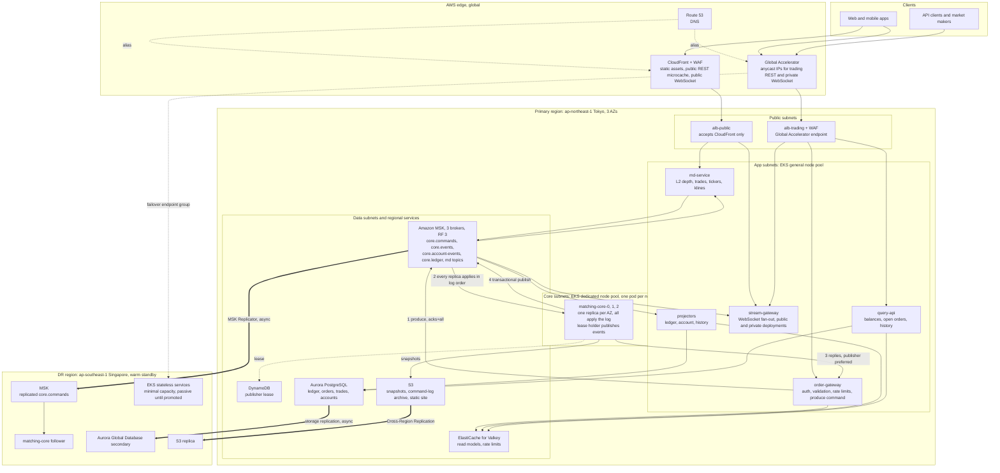
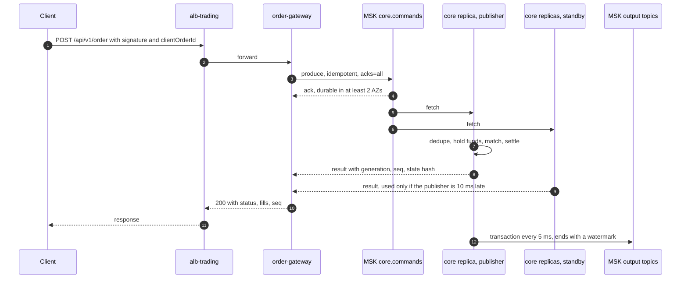

# Problem 1: Building Castle In The Cloud

A highly available spot exchange on AWS. It covers the parts of a Binance-like platform where the infrastructure decisions are hardest: order entry and matching, balances and the ledger, and market data fan-out.

## TL;DR

**Scope.** Spot order entry (limit, market, cancel, IOC/FOK), price-time matching, balance holds and settlement with a double-entry ledger, public market data and private user streams over WebSocket, and order/trade history. Custody, fiat, KYC, derivatives and security hardening are out of scope (Problem 5 adds security to this design).

**The decisions that matter**

1. **The matching core is a deterministic state machine over a replicated log.**
   - Commands are appended to a single-partition topic on Amazon MSK (`acks=all`, replicas in 3 AZs).
   - Three core replicas apply the same log. The one holding a lease publishes events, and Kafka transactional fencing stops a second publisher.
   - Every outcome has an application-level identity, `(generation, seq, event_index)`, that survives replication. Recovery, publisher failover and DR are therefore all the same thing: replay into idempotent consumers.
2. **One core owns every symbol and every balance at launch.** Risk check, hold, match and settlement are one in-memory step, with no distributed transaction. Sharding is Stage 3, behind a measured trigger.
3. **Only `order-gateway`, MSK and `matching-core` are on the order path.** Valkey rate limiting also sits on it, but fails open. Aurora, read models, market data and projectors are downstream and can fail without stopping order entry.
4. **Two edges.**
   - Global Accelerator for authenticated trading.
   - CloudFront for static assets, public market data and public WebSocket, which is where the egress bytes are.
5. **Regional DR is a warm standby with asynchronous replication and a human-initiated, fenced failover.**
   - Synchronous cross-region commit would spend ~70 ms (Tokyo-Singapore RTT) of the 100 ms budget, so replication is asynchronous.
   - No promotion happens until the old region's writer is verifiably halted. If that cannot be verified, the exchange stays down: downtime is preferred to two order books.

### Guarantees and targets

This is the authoritative list; later sections explain how each row holds and do not restate it. *Enforced* means a violation requires a bug. *Target* means measured and alarmed, not bounded.

| ID | Property | Value | Kind | Basis |
|---|---|---|---|---|
| G1 | Order place/cancel latency, server-side at the ALB | p99 < 100 ms (brief); internal p99 < 50 ms | Target; the launch gate is an end-to-end load test | Allocation and gate in section 3 |
| G2 | An acknowledged command survives the loss of an AZ | RPO 0 | Enforced | `acks=all`, `min.insync.replicas=2`, unclean leader election off |
| G3 | No double execution, no double publication | | Enforced | Determinism, exact dedupe, transactional fencing, event identity (section 4) |
| G4 | Never two active regions | | Enforced by the failover protocol | Verified `Halt` or SCP fence before promotion (8.2) |
| G5 | Order-entry pause on AZ loss | ~10-15 s | Expected; drilled | Kafka broker-crash detection (9 s KRaft session timeout) plus leader election |
| G6 | Loss of a core replica | No order-entry pause; event publication gap up to ~5 s | Expected; drilled | Reply hedging, 3 s lease |
| G7 | Regional data loss | Replication lag p99 < 5 s | **Target, not a bound** | Actual loss is the unreplicated gap when Tokyo is lost, and can be larger if replication was already broken. Zero if Tokyo can be halted and drained first |
| G8 | Regional RTO, measured from the verified halt | Cancel-only in 15 min, full trading in 30 min | Drill target | Gates in section 8.2 |
| G9 | Order requests that get a definitive answer (client 4xx and 429 excluded) | 99.95% per 28 days | SLO | Section 3 outcomes |
| G10 | Trades and private events, match to socket | p99 < 100 ms | SLO; may degrade during bursts (section 10) | Depth is conflated by design: its freshness is the subscription interval + 100 ms |
| G11 | Ledger projection lag | p99 < 2 s; may breach during bursts, never loses data | SLO | Kafka buffers; projectors catch up |
| G12 | Burst headroom with no scaling event | 10x launch commands on the order path; launch peak with one AZ lost everywhere else | Design target; load-tested | Section 10 |
| G13 | Cost | ~$12.4k/month on-demand for primary + warm DR; ~$11.2k with 1-year Savings Plans | Estimate | Section 10 |

---

## 1. Scope and assumptions

### 1.1 Out of scope

- **Custody, deposits, withdrawals.** A separate trust domain (HSM/MPC wallets, chain nodes). Only the interface is defined: the wallet service submits `Credit`, `HoldForWithdrawal`, `ConfirmWithdrawal` and `ReleaseHold` to the core log, so balances keep one writer.
- **Fiat, KYC/AML, identity provider.** Third-party integrations. The gateway validates sessions and API keys; it does not issue them.
- **Margin, futures, options, Earn, P2P, back office.** Product breadth; derivatives would be a separate core on the same pattern.
- **Security controls.** Problem 5. The trust tiers here (edge, public, app, core, data) are kept explicit so that work can be layered on.

### 1.2 Assumptions

| ID | Assumption |
|---|---|
| A1 | "500 rps" is the sustained peak of REST requests at the edge. WebSocket pushes are messages, not requests, and have their own SLO (G10). |
| A2 | "p99 < 100 ms" is server-side, measured at the ALB in the primary region. Client RTT is excluded (Europe to Tokyo alone is over 200 ms); an in-region canary also measures the path through Global Accelerator. |
| A3 | APAC-heavy users, including market makers. Primary **ap-northeast-1 (Tokyo)**, near liquidity providers. DR **ap-southeast-1 (Singapore)**: different seismic zone and jurisdiction, ~70 ms RTT. |
| A4 | Launch scale: ~100 symbols, ~1M accounts, 10k concurrent WebSocket connections at peak, ~100 trades/s. |
| A5 | The team already runs Kubernetes and Kafka. This is why EKS is chosen over ECS. |
| A6 | Costs use Tokyo/Singapore on-demand list prices, rounded. They are order-of-magnitude. |

### 1.3 The 500 rps, decomposed

| Traffic class | Launch rps | Path | Latency target |
|---|---|---|---|
| Order commands (40% place, 60% cancel) | 200 | Global Accelerator, `alb-trading`, `order-gateway`, core | G1 |
| Private reads: balances, open orders, order status | 120 | Global Accelerator, `alb-trading`, `query-api`, Valkey | p99 < 25 ms |
| Private history | 30 | Global Accelerator, `alb-trading`, `query-api`, Aurora reader | p99 < 50 ms |
| Public market data REST: depth, ticker, klines | 150 | CloudFront (1 s microcache), `alb-public`, `md-service` | p99 < 100 ms at origin |
| WebSocket push | 10k connections, ~40k msg/s out | CloudFront or Global Accelerator, `stream-gateway` | G10 |

---

## 2. Architecture overview

| Component | Runs on | Role |
|---|---|---|
| `order-gateway` | EKS general pool, 2 pods per AZ | REST order API: auth, validation, rate limits, produce to `core.commands`, return the core's reply |
| `matching-core-0..2` | EKS core pool, one `c7g.2xlarge` each, one per AZ | Apply `core.commands` (dedupe, holds, matching, settlement); all reply, the lease holder publishes |
| `md-service` | EKS general pool | L2 depth diffs, trades, tickers, klines from `core.events`; REST snapshots |
| `stream-gateway` | EKS general pool; one image, two deployments: public behind `alb-public`, private behind `alb-trading` | WebSocket termination, in-band snapshots, conflation |
| `query-api` | EKS general pool | Balances and open orders from Valkey; history from Aurora readers |
| `ledger-projector`, `account-projector`, `history-projector` | EKS general pool | Idempotent consumers that build the ledger and read models |
| `archiver` | EKS general pool | Copies `core.commands` to S3 permanently |

**Network.** Each region has one VPC across 3 AZs with four subnet tiers: public (ALBs, NAT), app, core and data. The core has its own tier so Problem 5 can give it the tightest policy. Gateway endpoints (S3, DynamoDB) and interface endpoints (ECR, STS, CloudWatch, KMS, Secrets Manager) keep AWS API traffic off NAT. No cross-region VPC connectivity is needed: MSK Replicator (with multi-VPC private connectivity on the source cluster), Aurora Global Database and S3 replication are all service-managed.

---

## 3. The order path and its latency budget

**Engineering allocation for place/cancel (milliseconds)**

| Hop | ms |
|---|---|
| ALB request and response processing | 3 |
| `order-gateway`: signature, schema, symbol rules (in-memory) | 2 |
| Valkey rate-limit check (5 ms timeout, then fail open to a per-pod bucket) | 2 |
| MSK produce, `acks=all`, `linger.ms=0`, inter-AZ RTT ~1 ms, under 1 MB/s | 15 |
| Core fetch: the long-poll returns when the high watermark advances | 5 |
| Core apply | 1 |
| Reply over gRPC: publisher preferred, standby after 10 ms | 2 (12 when hedging) |
| **Total** | **30** |

These numbers are allocations for engineering work, not a percentile bound. Tails of different hops can land on the same request, and the table does not model queueing.

**Launch gate.** The commitment is an end-to-end load test at 2,000 commands/s with the launch mix (60% cancels, sweeps up to the fill limit, 10 s bursts at 5x), repeated with a broker restarting and with one AZ removed. It passes at ALB p99 under 50 ms normally and under 100 ms degraded. If MSK misses its share, fall back to Express brokers or Stage 4. Reads skip the log: about 7 ms via Valkey, 30 ms via an Aurora reader.

**Outcomes the API reports**

| Outcome | When | What the client does |
|---|---|---|
| Rejected | Only when a check fails *before* the command is handed to the producer: auth, validation, rate limit, load shedding | Fix the request or back off |
| Accepted, result pending | The produce was acknowledged, but no core reply arrived by the 1 s API deadline. The command is durable and will execute, unless it is lost in a regional failover (G7) | Read the result from the user stream |
| Outcome unknown | Any producer error or timeout after handoff. The command may or may not be in the log (Binance's `-1007` contract) | Query the order, or resubmit the same `clientOrderId` (section 4.2) |

Producer timeouts (Appendix A) satisfy Kafka's rule `delivery.timeout.ms >= request.timeout.ms + linger.ms`. The gateway enforces the 1 s API deadline separately.

**Overload.** The gateway sheds load instead of queueing it. Priority: cancels first, then new orders, then reads. Per-account order-rate limits are enforced exactly inside the core. Per-IP and per-key request limits are enforced in the gateway.

---

## 4. The matching core

### 4.1 Determinism and workload limits

**Execution model.**
- One thread applies commands in log order.
- Integer arithmetic only, in tick and lot units.
- No clock reads, no randomness, and no logic that depends on hash-map iteration order.
- Each command applies atomically: validate it, compute every change, then commit. A business rejection changes no state.

**Time and configuration.**
- **Exchange time** is the gateway timestamp carried in the command, made monotonic by the core: `t = max(t_prev, t_cmd)`.
  - Every producer that stamps time (gateways, the publisher's ticker) checks the Amazon Time Sync clock error bound before each produce, and refuses to enqueue when it exceeds 1 ms. Health checks only report that state.
  - Kafka `LogAppendTime` is not used, because replication rewrites it.
  - The publisher appends a `Tick` every 100 ms so time-based rules advance when there is no traffic.
- **Behavior changes** activate through a `SetConfig` command at a specific `seq`, so replaying old log sections reproduces them exactly.

**Workload limits** bound the work any one command can cause:
- price band of ±5% around the last trade
- at most 50 fills per command. A FOK order is checked against this limit before execution; if it would need more, it expires whole with no state change. For other order types the remainder beyond the cap expires, because a limit order cannot rest while it still crosses the book.
- at most 200 open orders per account per symbol, and 20k resting orders per symbol

**Capacity and memory are benchmark targets, not claims.** Assumed state: 2M resting orders, 1M accounts with ~5 assets each, ~7M `clientOrderId` entries (24 h of launch placements) and ~10M wallet operations. At ~200 B per record that is ~5 GB, which fits in 16 GB with room for snapshot serialization. With that state loaded and the launch mix running, one thread must sustain 20k commands/s, 10x the burst design point. Both checks are part of the launch gate.

### 4.2 Identity and deduplication

- **Identity.** Kafka offsets are transport only. The core holds a `generation`, which starts at 1 and is incremented by `Promote` (section 8.2). It assigns a `seq` to every applied command.
  - Event identity: `(generation, seq, event_index)`.
  - Ledger posting identity: `(generation, seq, event_index, posting_index)`.
  - Every consumer is idempotent on the identity it consumes.
- **Transport duplicates.** These come from producer retries and from at-least-once replication.
  - Every producer (gateway instance, the publisher's ticker, the wallet service) stamps `(producer_id, producer_seq)`, strictly increasing per producer.
  - The core keeps the highest `producer_seq` per producer in its state and drops anything at or below it.
  - This is exact and needs no time window. It behaves identically in DR, because replication preserves per-partition order, so a resent record always carries an already-seen `producer_seq`.
  - Gateways never resend a command themselves. A retry is a new submission that relies on business idempotency.
- **Business idempotency.**
  - **Orders:** `(account, clientOrderId)` is unique among orders created in the last 24 h of exchange time. A resubmission inside that window returns the existing order. After it, the ID may be reused and creates a new order.
  - **Wallet operations** (credits, withdrawal holds) carry the wallet service's `operation_id` and have an explicit state in both the core and the ledger: `applied`, `reversed` or `reinstated`. Each transition is idempotent on `(operation_id, transition)` and is kept permanently (the volume is low), so a duplicated credit cannot create money. An ID is never reused.
- **Region.** Every command carries its origin region. The core applies only commands from its generation's active region, so a passive region's gateways cannot change the book even if traffic reaches them. The one exception is `Promote`, which only the operator role can produce.

### 4.3 Replies and the fault model

- **Reply rule.** All three replicas consume `core.commands` with manual partition assignment and reply over gRPC. The gateway returns the publisher's reply. If the publisher's reply arrives 10 ms after a standby's, the gateway uses the standby's.
- **Tolerated faults:** crash, omission or slowness of up to two replicas. Order entry continues with no failover step.
- **Detected but not masked: divergence**, meaning a determinism bug or memory corruption. Every reply carries the replica's rolling state hash. On any mismatch:
  1. Automation appends `SetMode(cancel-only)`.
  2. New orders stop until a scratch replay of the archived log determines the correct outcome.
  3. Replies or published events that disagree with that outcome are fixed as trade corrections, and affected clients are notified on the user stream.

  We accept this rather than a 2-of-3 reply vote, which would stall order entry whenever two replicas are down.

### 4.4 Publication and publisher failover

The lease holder publishes `core.events` (partitioned by symbol), `core.account-events` (partitioned by account) and `core.ledger` (single partition) in one Kafka transaction every 5 ms. Each transaction ends with a `Watermark(generation, seq)` record on `core.ledger`. The last committed watermark, W, is therefore exactly what has been published.

Failover:
1. A standby acquires the lease once it expires. The lease is a DynamoDB conditional write on `{owner, epoch, expires_at}`: 3 s lease, renewed every 500 ms.
2. It calls `initTransactions()` with the stable `transactional.id` `core-0`. Kafka aborts the old publisher's open transaction and rejects all of its later writes.
3. It reads W with `read_committed` and re-emits everything after W. It uses its ring buffer, or regenerates the events from the newest snapshot at or before W; snapshots are retained so that one always exists.
4. Consumers deduplicate on event identity, so any overlap is harmless.

Liveness comes from the lease, safety from Kafka. A publisher steps down only when fenced or unhealthy, so a DynamoDB outage blocks failover but not trading.

### 4.5 Snapshots and faults

- **Snapshots.** A standby (never the publisher) takes a versioned, checksummed snapshot every 5 minutes of exchange time, at a `seq` boundary. It holds books, balances and holds, `generation`, `seq`, active region, exchange time, per-producer progress, the `clientOrderId` and `operation_id` indexes, rate-limit windows, last-trade prices, active config and W. CI asserts that snapshot plus replay equals uninterrupted execution.
- **Recovery.** A replacement replica loads the latest snapshot and replays from there: about 60k commands at launch volume, roughly a second. Snapshots and `core.commands` are both kept for 7 days; the `archiver` keeps the full log in S3 permanently.
- **`Halt` is state.** Every replica start replays it, so a halted region stays halted until a later `Resume` in its own log.
- **Runtime faults are not business outcomes.** On an allocation failure or a failed assertion, the replica exits and is rebuilt from a snapshot. If every replica fails on the same command, that is a deterministic bug: trading halts until a hotfix passes a replay of the log up to that command. Fuzzing and property tests of the core are the prevention.

---

## 5. Balances and the ledger

- **Holds make trading safe without distributed transactions.** A buy of 1 BTC at 60,000 USDT moves 60,000 USDT plus the maximum fee from `available` to `held` before it can rest or match; fills move held funds between accounts and fees to the fee account. Per asset, `available + held` summed over all accounts never changes through trading.
- **Authority.**
  - The command log is the system of record.
  - The core's balances are authoritative for trading decisions.
  - The Aurora double-entry ledger is a derived book of record, used for finance, statements and withdrawals.
- **Ordered, exactly-once projection.** `ledger-projector` consumes the single-partition `core.ledger` topic in `seq` order. In one transaction, it writes the balanced journal entries (posting identity is `UNIQUE`) together with the last applied watermark.
- **Reconciliation at a consistent cut.** The core and the ledger each maintain incremental hashes over 1,024 account buckets. At every snapshot `seq` S, the core writes its bucket hashes into `core.ledger` at S, and the projector compares them with its own when it reaches that record. A mismatch pages and freezes withdrawals. Trading continues, because the core is authoritative for trading. A scratch replay decides which side is wrong.
- **Reads.** `account-projector` keeps balances and open orders in Valkey, tagged with `(generation, seq)`. Order responses return `seq`, so a client can tell when a read is older than its own last order.

---

## 6. Market data and user streams

- **Pipeline.** `core.events` feeds `md-service`, which publishes `md.depth`, `md.trades`, `md.ticker` and `md.kline`. Depth diffs carry `first_update_id` and `last_update_id`, so gaps are detectable.
- **No snapshot race.** Each `stream-gateway` pod keeps an L2 copy of every book. A new subscription gets an in-band snapshot followed by contiguous diffs. REST `/depth` is for polling clients and is microcached for 1 s at CloudFront.
- **Backpressure.** Each connection has a bounded send queue. When it fills, the connection falls back to conflated snapshots. If it still falls behind, it is disconnected with a resync code. The fan-out loop never blocks on a slow socket.
- **Conflation defaults.** Depth every 1000 ms for web, 100 ms on request for API clients. Trades are not conflated.
- **User streams.** At launch every private `stream-gateway` pod reads all of `core.account-events` (1-2k events/s) and filters to its connected accounts. Stage 2 replaces this.
- **Reconnect storms.** Pods drain over 60 s with randomized closes; clients back off with jitter.

---

## 7. Consistency vs. availability

| Data path | Choice | Under failure |
|---|---|---|
| Order acceptance, matching, trading balances | **Consistency** | Nothing is acknowledged unless it is durable in 2+ AZs. Publisher failover pauses publication rather than risk two writers |
| Balance and open-order reads | **Availability**, with staleness visible through `seq` | Valkey; falls back to an Aurora reader |
| Market data | **Availability** | Clients detect gaps by sequence id and resync; conflation under load |
| Aurora ledger | Eventually consistent with the core (G11) | A backlog builds in Kafka during an Aurora failover, then drains |
| Withdrawals (interface only) | **Consistency**, plus the reconciliation gate | Holds go through the core; withdrawals freeze on any mismatch |

---

## 8. High availability and disaster recovery

### 8.1 Failure handling per component

| Failure | Effect | Recovery |
|---|---|---|
| Core replica, including the publisher | G6 | Lease takeover and fencing (4.4); reschedule; snapshot + replay |
| MSK broker crash | A controlled restart moves leadership in under 1 s; a crash pauses order entry per G5 | Automatic; no loss (G2) |
| Slow, not dead, MSK follower | `acks=all` latency rises. The follower stays in the ISR as long as it keeps making progress | Alarm when produce p99 exceeds its 15 ms allocation for 5 min; replace the broker; drilled |
| AZ loss | G5 on the order path; ARC zonal shift on the ALB and EKS handles gray failures | Automatic; the two remaining AZs carry launch peak (G12) |
| Aurora writer | 30-60 s failover; ledger and history lag; order entry unaffected | Automatic; projectors resume from their watermark |
| Valkey primary | Reads fall back to Aurora; rate limits fall back to per-pod buckets | Automatic failover; projector refills |
| DynamoDB | No publisher failover possible meanwhile; trading continues | Wait |
| Divergence, poison command | Sections 4.3 and 4.5 | |
| Region | G7, G8 | Section 8.2 |

**Regional RPO/RTO by component.** Core and command log: G7, G8. Aurora: Global Database lag is typically under 1 s, and it is repaired at promotion (step 5). Valkey: rebuilt from the DR core's snapshot. S3: Cross-Region Replication within minutes, not on the recovery path. Stateless services: Karpenter, within G8.

### 8.2 Regional failover protocol

**Invariant:** at most one region's core accepts commands at any time.

1. **Declare.** The incident commander and the head of trading operations declare a regional failover when Tokyo order entry has been down for more than 5 minutes with no credible ETA, or when AWS confirms a regional impairment.
2. **Halt Tokyo durably.** Use either method:
   - **Preferred:** append `Halt` to Tokyo's log and read back that it was applied (4.5).
   - **If Tokyo's MSK is unreachable:** attach a pre-staged Organizations SCP denying Tokyo's core and gateway roles access to Tokyo's `core.commands`, snapshot bucket and lease, and confirm a test call is denied. Then terminate the core instances, confirmed via the EC2 API. Organizations is global; no replacement core can load state, whoever launches it.

   Set Tokyo's Global Accelerator traffic dial to 0. **If neither method can be verified, do not promote:** two order books are worse than an outage.
3. **Drain, then cut replication.** If Tokyo's MSK is reachable, wait for replication lag to reach zero. Then stop the MSK Replicator (a DR-region call) and record the last replicated command, `S_last`.
4. **Promote.** Append `Promote(region=ap-southeast-1)` to the DR log. The core increments `generation`, so no new identity can collide with Tokyo's lost suffix, and enters a replicated `halted` mode in which it accepts operator commands only.
5. **Rebuild downstream from the DR log.**
   - Every projector resumes from its own durable watermark, which Aurora holds alongside the projector's data and which arrives with the Global Database failover. The DR publisher regenerates events from a retained snapshot at or before the lowest of those watermarks and `S_last`. Identity deduplication absorbs the overlap. Valkey is rebuilt from the core's snapshot.
   - Tokyo's discarded suffix (old generation, `seq > S_last`) needs repair: the ledger posts reversals. Orders it touched get status and filled quantity rebuilt from the canonical prefix; discarded fills and cancels become busted audit records.
   - Deposits and withdrawals beyond `S_last` are reconciled against the wallet and custody system, because for them the chain is the source of truth, not either log. The operator appends each outcome to the DR log as a `reversed` or `reinstated` transition (4.2). A later wallet retry is then a no-op.
6. **Reopen in two steps.**
   - **`SetMode(cancel-only)`** after step 4, once DR `alb-trading` pods pass health checks and the Route 53 public-origin record points at Singapore. While passive, those pods deliberately fail health checks, because Global Accelerator ignores traffic dials during failover.
   - **`SetMode(trading)`** after step 5, green reconciliation (balances, plus status and filled quantity of suffix-touched orders), two more core replicas from the snapshot, and stateless fleets at launch size. DR capacity is not reserved; if drills show risk, On-Demand Capacity Reservations (~$550/month) are the lever.
7. **Afterwards.** List Tokyo's suffix beyond `S_last`, and compensate the busted trades per the published policy. Rebuild Tokyo as the follower before lifting any SCP. Failback is a planned switchover with a drain.

**Drills.** Every quarter in staging; a planned switchover in production once a year.

---

## 9. Service choices and alternatives

| Service | Job | Alternatives considered | Why this one |
|---|---|---|---|
| **Global Accelerator** | Trading REST and private WebSocket ingress | **CloudFront:** origin failover covers only GET/HEAD/OPTIONS, so `POST /order` cannot fail over, and signed requests are uncacheable. **Route 53 to the ALB:** DNS caching makes failover unpredictable; public-internet path | Static anycast IPs institutions can allowlist; edge TCP termination and AWS backbone; health-based failover. $18/month plus a small per-GB premium |
| **CloudFront** | Static web, public REST microcache, public WebSocket | Global Accelerator: per-GB premium on the highest-volume traffic, no cache | Most bytes and public requests are market data; cheapest egress path |
| **AWS WAF**, Shield Standard | On CloudFront and `alb-trading` | | Rules are Problem 5's job; the attachment points are fixed here |
| **ALB x2** | `alb-public` (CloudFront origin only) and `alb-trading` (Global Accelerator endpoint) | **NLB:** no L7 routing or WAF; Stage 4. **API Gateway:** $1.00-3.50 per million (us-east-1, tiered) is ~$1k-3k/month for ~0.9B authenticated requests, plus a hop | Cheapest L7 at sustained rps; two ALBs keep two trust zones |
| **EKS** | All services; the core on a tainted pool with the static CPU manager | **ECS on Fargate:** no CPU pinning. **ECS on EC2:** sufficient. **Lambda:** wrong fit for long-lived consumers, sockets and in-memory state | Team fit (A5), plus Karpenter, Argo Rollouts, PodDisruptionBudgets and topology spread |
| **EC2 Graviton** (`c7g`, `m7g`) | Compute | `c7i` for the core | About 20% below the x86 hourly price. The core is benchmarked on both, because single-thread tail latency decides it |
| **Amazon MSK** (provisioned, KRaft, 3x `kafka.m7g.large`) | The sequencer (`core.commands`) and the event bus | **Kinesis:** AWS documents ~70 ms average propagation with enhanced fan-out (~200 ms polling), and no transactional fencing. **Aeron Cluster:** lowest latency, self-operated; Stage 4. **SQS FIFO:** no replay. **MSK Express:** faster recovery at ~2x the broker price | Total order, durable cross-AZ acks, replay, and the transactional fencing the failover design relies on |
| **DynamoDB** | The publisher lease | **Kubernetes Lease:** ties trading to the EKS control plane. **Kafka group membership:** 6 s default session-timeout floor. **etcd/ZooKeeper:** another quorum to run | Strongly consistent conditional writes in an independent failure domain, for a few dollars a month |
| **Aurora PostgreSQL** (writer + reader, `db.r7g.xlarge`) | Ledger, order and trade history, accounts | **RDS PostgreSQL:** weaker cross-region DR. **DynamoDB:** awkward for balanced entries and reconciliation SQL; used for history in Stage 2. **Aurora DSQL:** its write latency buys nothing for a ledger off the hot path | Relational constraints, SQL for finance, six-way storage, Global Database |
| **ElastiCache for Valkey** | Account read model, rate limits, key and ticker caches | **MemoryDB:** pays for durability on data that can be rebuilt. **Redis OSS:** same API at a higher price | Sub-millisecond reads at about 20% below the Redis OSS node price |
| **S3** | Snapshots, permanent command-log archive, static site, history archive | | Cheapest durable storage |
| **MSK Replicator** | Async copy of `core.commands` to Singapore | Self-run MirrorMaker 2 | Managed; at-least-once is safe given per-producer dedupe (4.2). Outputs are regenerated in DR |
| **Aurora Global Database** | Ledger and history in DR | Logical replication | Storage-level, typical lag under 1 s; repaired at promotion (8.2) |
| **Route 53** | DNS; a low-TTL record for the public origin | | Alias records to CloudFront and Global Accelerator |
| **Observability:** OTel Collector (ADOT), Amazon Managed Service for Prometheus, Amazon Managed Grafana, CloudWatch, X-Ray | Metrics, dashboards, alarms, logs, traces | Self-hosted Prometheus, Loki and Tempo | Managed at launch. Logs move to self-hosting if CloudWatch Logs passes ~$2k/month |
| **KMS, Secrets Manager** | Encryption at rest, credentials | | Problem 5 |

Not used on any trading path: Lambda, Step Functions, SNS/SQS, API Gateway, Kinesis. Each fails the latency budget or duplicates an existing component.

---

## 10. Capacity and cost

### Sizing (G12)

- **Order path.** The core, MSK and `order-gateway` are sized for a 10x burst (2,000 commands/s) with no scaling event, because crypto spikes outrun autoscaling. The core's share is the 4.1 benchmark. Commands are well under 1 MB/s. `order-gateway` has six 1-vCPU pods; with one AZ lost, four remain at ~500 rps each.
- **Everything else** runs 2 pods per AZ, sized so that the four survivors carry launch peak after an AZ loss. For example, `stream-gateway` would hold ~2.5k connections per pod, under its 5k scaling threshold. Load beyond that is handled by HPA and Karpenter within minutes.
- **Event amplification**, assumed at the burst point:
  - An average of 2 fills per placement gives ~1,600 fills/s and ~5 MB/s of output before replication. The 50-fill cap bounds the worst single command, not the average.
  - The MSK launch gate (section 3) runs command, output and replication traffic together, with one AZ unavailable.
  - G10 and G11 may degrade during bursts. Consumers absorb the excess as lag; nothing is lost.
- **Node pools.** General: ~24 vCPU of requests on 8x `m7g.xlarge`. Core: 3x `c7g.2xlarge`, with one pinned matching thread and the 4.1 state in 16 GB.
- **Egress.** 10k connections at ~4 msg/s and ~150 B compressed is ~6 MB/s at peak. With REST and static content, at a 50% average-to-peak ratio, that is ~9 TB/month.

### Monthly estimate (on-demand, USD)

| Item | Sizing (primary / DR) | Primary (Tokyo) | DR (Singapore) |
|---|---|---|---|
| EKS control plane | 1 per region | 73 | 73 |
| General nodes | 8 / 3 `m7g.xlarge` | 1,230 | 450 |
| Core nodes | 3 / 1 `c7g.2xlarge` | 800 | 270 |
| MSK | 3 `kafka.m7g.large` + 1.5 TB per region | 730 | 700 |
| MSK Replicator | Hourly fee + ~0.2 TB/month + cross-region transfer | | 250 |
| Aurora PostgreSQL | 2 / 1 `db.r7g.xlarge` + storage and I/O | 1,200 | 600 |
| ElastiCache for Valkey | 3 / 2 `cache.r7g.large` | 460 | 300 |
| ALB x2 | Hours + LCU | 200 | 100 |
| Global Accelerator | Fixed fee + per-GB premium | 50 | |
| CloudFront | ~9 TB egress + ~400M requests | 1,500 | |
| AWS WAF | ~1.3B requests | 800 | |
| NAT and VPC endpoints | 3 NAT gateways, ~7 interface endpoints x 3 AZs | 350 | 200 |
| Data transfer | Cross-AZ, API egress | 200 | |
| Observability | ~150k active series, ~0.5 TB logs, sampled traces | 1,300 | 200 |
| S3, DynamoDB, KMS, Secrets Manager, backups | | 250 | 100 |
| **Total** | | **~9,150** | **~3,250** |

**~$12.4k/month on-demand.** A 1-year Compute Savings Plan on EC2 (~28%) and Database Savings Plans on Aurora and Valkey (~20%) bring it to ~$11.2k. The estimate excludes support, non-production environments (about +30%), custody, KYC vendors and chain nodes.

**Where the money goes:**
- DR: ~26%
- edge egress and WAF: ~20%
- observability: ~12%
- compute: under 25%

**Levers, largest first:**
1. **WebSocket egress:** permessage-deflate (about 3-5x on JSON), 1000 ms depth conflation by default (a 10x cut on the largest stream), binary encoding for API clients, and a CloudFront flat-rate plan if its allowances fit.
2. **WAF** bills every inspected request; moving pollers to WebSocket cuts WAF and CloudFront request charges.
3. **Savings Plans** on the steady baseline. Spot only for interruptible work (`archiver`, CI replays), never for gateways or the core.
4. **DR posture.** Pilot light saves ~$1.5k/month but pushes regional RTO to 1-2 hours; a business decision, and we recommend warm.
5. **Observability.** Sample successful access logs, use the CloudWatch Logs Infrequent Access class, and keep per-account labels out of metrics.
6. **Aurora I/O-Optimized**, once I/O exceeds ~25% of Aurora spend.

---

## 11. Scaling plan

**Stage 0 (launch).** 500 rps, 200 commands/s, 10k connections, one core, ~100 symbols.

**Stage 1: grow within the design (up to ~5x), mostly automatic**

| Component | Trigger | Action |
|---|---|---|
| `order-gateway`, `query-api` | CPU p95 > 50% for 5 min | HPA and Karpenter |
| `stream-gateway` | > 5,000 connections per pod | HPA on a custom metric |
| Valkey | CPU > 60% or memory > 70% | Add a shard online |
| Aurora | Writer CPU p95 > 60% or ledger lag p99 > 2 s; reader CPU > 60% | One size up via reader promotion; add readers |
| MSK | Broker CPU > 50%, disk > 60%, or produce p99 > 10 ms | Add brokers, or move to larger or Express brokers |
| `matching-core` | Matching thread busy > 15% at the 1-minute peak | Start Stage 3 design work |

**Stage 2: fan-out and history**

*Trigger:* more than 50k connections, more than 10k account events/s, more than 30 `stream-gateway` pods, or history inserts above 10k rows/s.
- **Routed user streams:** an `account -> pod` registry in Valkey, plus a router over the account-partitioned topic, so pods no longer read every account's events.
- **Market data by symbol group:** md topics are split by symbol group, and pods consume only the groups they serve.
- **History to DynamoDB:** order and trade history moves to DynamoDB (`pk = account_id`), with data older than 90 days in S3/Athena. Aurora keeps the ledger.

**Stage 3: shard the core (future design work)**

*Trigger:* the matching thread is busy > 25% at the 1-minute peak, `core.commands` exceeds 20 MB/s, snapshot plus replay exceeds 60 s, or a new product needs isolation.

- **Target shape:** an account-sharded `risk-core` for holds and settlement, a symbol-sharded `matching-core`, each the same replicated state machine. The extra durable hop adds about 15-20 ms, still inside G1.
- **Not specified here.** The protocol must cover a durable outbox between shards, an idempotent order/hold state machine (including a cancel that overtakes its order), releasing a hold only on a terminal acknowledgment, and migrating balances and resting orders at a snapshot boundary. Commands already carry both `account` and `symbol`.

**Stage 4: latency tier**

*Trigger:* market makers contract for p99 under 10 ms, or MSK produce p99 stays above 25 ms, a quarter of the 100 ms budget, after the Stage 1 remedies.
- Raft log inside the core (Aeron Cluster across 3 AZs).
- NLB-fronted gateways and PrivateLink for co-located clients.
- Kafka stays as the event bus.

**Non-goal: active-active matching of one symbol across regions.** A single writer per book and a 70 ms inter-region RTT make it the wrong trade. Multi-region growth means read-only market data edges, or separate per-jurisdiction exchanges.

---

## 12. Operability

**Alerting**
- **Burn-rate pages** on G1 and G9: 14.4x over 1 h and 5 min, and 6x over 6 h and 30 min. A ticket at 1x over 3 days.
- **Invariant pages, on the first occurrence:** replica state-hash mismatch, reconciliation mismatch, `UnderMinIsrPartitionCount > 0` on `core.commands`, more than two lease changes in 10 minutes, core apply lag > 500 ms, snapshot age > 15 minutes, replication lag > 5 s (G7).
- **Tickets** at the Stage 1 thresholds.

**Deployment and rollback**
- **Stateless services:** Argo Rollouts canary (5%, 25%, 100%) with automated SLI analysis and abort, promoted dev, staging, prod. A nightly job in an isolated account replays the previous day's production log against the current build.
- **The core.**
  1. **CI replay gate.** The candidate runs the last 24 h of production `core.commands` from the S3 archive. Its output must be byte-identical, except where a change is gated behind a `SetConfig`.
  2. **Shadow.** The candidate runs on one standby in shadow mode: its replies are compared, never returned. It also runs on the DR follower, where state hashes are compared at each snapshot. At least 24 h in total.
  3. **Handover** in the weekly low. An operator appends `Handover`; at that `seq` the candidate takes the lease. Publication pauses for under 1 s; replies do not pause.
  4. **Rollback.** An old-version replica keeps running for 7 days; rollback is the reverse handover. It is only possible while the new behavior is still switched off. After a `SetConfig` activation, roll forward.
- **Aurora schema changes:** expand, migrate, contract; the order path does not depend on the schema.
- **MSK maintenance:** rolling controlled restarts in the weekly low.

**Game days** (monthly in staging, quarterly in production): kill the publisher, zonal-shift an AZ, restart or slow a broker under load, fail over Aurora.

---

## 13. Risks and open questions

| Risk | Mitigation or next step |
|---|---|
| MSK tail latency (gray followers, maintenance) is the largest share of G1 | Launch gate (section 3); Express brokers or Stage 4 if it fails |
| Determinism discipline: one non-deterministic path diverges the replicas | Replay gate, shadow comparison, live state hashes, cancel-only on mismatch |
| Regional data loss above zero, plus "stay down" when the halt cannot be verified | Business sign-off on the bust/compensation policy and on choosing downtime over split-brain |
| MSK Replicator lag under load is not well documented | Measure it in the load test; alarm at 5 s |
| Egress (cost) and state population (memory) are assumptions | Measure bytes per connection in beta; populated-state benchmark (4.1) |
| Workload limits (4.1) are stricter than some venues' | Product sign-off; raise them only together with a re-run of the benchmark |

---

## Appendix A: settings the guarantees depend on

| Setting | Value | Supports |
|---|---|---|
| `core.commands` partitions | 1 | Total order |
| `replication.factor`, `min.insync.replicas` | 3 (one replica per AZ), 2 | G2 |
| `unclean.leader.election.enable` | false | G2 |
| Cluster metadata mode | KRaft (Kafka 3.7+) | G5: 9 s broker session timeout |
| Gateway producer | `acks=all`, `enable.idempotence=true`, `linger.ms=0`, `request.timeout.ms=800`, `delivery.timeout.ms=900`, `max.block.ms=100` | G1, G2; satisfies `delivery >= request + linger` |
| Command fields | `producer_id`, `producer_seq`, `account`, `symbol`, origin region, gateway timestamp | G3, G4, deterministic time |
| Core output producer | `transactional.id=core-0`; every transaction ends with `Watermark(generation, seq)` | G3 |
| Downstream consumers | `isolation.level=read_committed`, idempotent on event or posting identity | G3 |
| `core.commands` retention | 7 days in MSK, permanent in S3 | Replay, audit |
| Publisher lease | 3 s, renewed every 500 ms | G6 |
| API deadline | 1 s, then "accepted, result pending" or "outcome unknown" | G9 |
