# Problem 5: Fortify The Castle

This secures the Problem 1 exchange (`src/problem1/SOLUTION.md`). Names and guarantee IDs (G1-G13) are Problem 1's; "P1 8.2" means its section 8.2. Changes to Problem 1's design are marked **CHANGED**; that file itself is untouched. The main body is a ten-minute read. [Appendix A](#appendix-a-protocol-details) holds the protocol mechanics, and [Appendix B](#appendix-b-control-register) the full control register (C1-C30).

## TL;DR

**Threat model.** Whoever can append to `core.commands` controls every balance, and whatever leaves through a withdrawal is gone for good. A bad trade can be busted; an on-chain transfer cannot. The design therefore concentrates on two chokepoints: who may write the log, and what authorizes a withdrawal or makes a deposit spendable.

**What changed**
1. **The core authorizes every command.** Kafka does not record who wrote a record, so every command now carries its producer class's signature, and the core checks that class before applying it. Authority-moving commands need two operators; a stop needs one.
2. **Every order is signed by a key the exchange never holds.** API clients use Ed25519, and web and mobile apps a device-bound session key. A compromised gateway cannot sign as a user, so its forgeries are detectable: they freeze withdrawals before value leaves, and the trades are busted (4.1).
3. **Two independent checks gate the custody boundary.** Custody broadcasts only when the core's attestation and an independent verifier's match. A credit becomes spendable only with a separate deposit attestation.
4. **No standing human power.** No standing write access; no `exec` into the core outside break-glass; Object Lock on the archive and audit trail.
5. **No origin bypass, no egress.** Internal ALBs behind Global Accelerator and CloudFront, under Shield Advanced. Singapore runs the same controls.

**CHANGED in Problem 1's design:**
- signed commands with ordered credential revisions
- ticker-bounded time
- a withdrawal state machine and deposit attestation
- an authority epoch
- checkpointed recovery
- a custody generation switch
- IAM-only MSK on Kafka 3.8+
- internal ALBs with a CloudFront origin group for DR
- no NAT

**Refuse to ship without (6.1):**
1. IAM-only MSK
2. signed, class-authorized commands with the two-person rule
3. request-bound client signing
4. the withdrawal and deposit gate
5. organization guardrails
6. an immutable, checkpointed record
7. encryption fixed at creation
8. no origin bypass, with Shield Advanced
9. an untouchable core
10. an independent pen test plus the DR drill

**Cost and latency.** About +$4.8k/month (+39%), or +$6.3k without an existing Business support plan. About 3 ms is added to the order-path allocation (30 to 33 ms). G1 remains a launch-gate target.

---

## 1. Threat model

**Assets:** balances and the ledger, the right to append to `core.commands`, order flow before execution, accounts and keys, availability in volatility, and operator powers. Score = likelihood (1-3) x impact (1-4, where 4 is unbounded or irreversible loss of funds or of the record). Scores are inherent, before these controls; ties go to the threat nearer the balances.

| ID | Threat | How it happens here | L | I | Score | Section |
|---|---|---|---|---|---|---|
| T1 | Account takeover | Phishing, credential stuffing, SIM swap, leaked keys, social-engineered recovery | 3 | 3 | 9 | 3.1 |
| T2 | DDoS in volatility | L3/4 and L7 floods, WebSocket floods, direct ALB hits, invalid-signature floods | 3 | 3 | 9 | 3.2 |
| T3 | Forged command | A writer appends a `Credit`, a `Promote` or anyone's orders, fences `core-0`, or advances exchange time | 2 | 4 | 8 | 3.3 |
| T4 | Privileged abuse | One person promotes while Tokyo is live, edits the ledger, `exec`s into the core, or deletes the log | 2 | 4 | 8 | 3.4 |
| T5 | Custody boundary | An unbacked credit; a withdrawal of stolen value | 2 | 4 | 8 | 3.5 |
| T6 | Supply chain | A malicious image; a tampered frontend (the 2025 Bybit theft began with JavaScript injected into a vendor's S3-hosted UI) | 2 | 4 | 8 | 4.2 |
| T7 | DR as the weak path | Singapore drifts; promotion needs Tokyo, or one person | 2 | 4 | 8 | 4.3 |
| T8 | `order-gateway` compromise | RCE in the internet-facing parser | 2 | 3 | 6 | 4.1 |
| T9 | Order-flow leakage | Readers of the log, account events, the archive | 2 | 3 | 6 | 4.4 |
| T10 | PII breach | Contact data, KYC | 2 | 2 | 4 | 4.4 |

T3, T4 and T6 get likelihood 2 because exchange staff and suppliers are state-actor targets: the FBI attributed the 2024 DMM Bitcoin and 2025 Bybit thefts to North Korea, and both began with a compromised supplier.

**Principles that follow:**
1. Authorize where a command is applied.
2. Sign what grants authority.
3. One signature to stop, two people to start.
4. Nothing leaves, or becomes spendable, on one component's word.
5. Nothing on the order path makes a network call to authorize.
6. A control missing in Singapore is missing.

---

## 2. Updated architecture

Rendered: [diagram-secure.svg](diagram-secure.svg). The source, [diagram-secure.mmd](diagram-secure.mmd), is identical to the block below.

```mermaid
flowchart TB
  subgraph CLIENTS["Clients"]
    WEB["[~] Web and mobile apps<br/>passkeys, device-bound request signing"]
    BOTS["API clients and market makers<br/>Ed25519-signed requests"]
  end

  subgraph EDGE["AWS edge, global: Shield Advanced on every entry point"]
    R53["[~] Route 53<br/>registry lock, CAA"]
    CF["[~] CloudFront + WAF<br/>rate rules, Bot Control on web paths, CSP and SRI<br/>origin group: Tokyo, then Singapore VPC origin"]
    GA["[~] Global Accelerator<br/>client IP preserved"]
  end

  subgraph IDACC["Identity account: PII domain"]
    ID["[+] identity<br/>passkeys, sessions, API key registry"]
  end

  subgraph PRIMARY["Primary region: Tokyo. No workload subnet routes to the internet"]
    subgraph ING["Ingress subnets, private"]
      ALBP["[~] alb-public, internal<br/>CloudFront VPC origin only"]
      ALBT["[~] alb-trading, internal + WAF<br/>Global Accelerator only"]
    end
    subgraph APP["App subnets: EKS general node pool"]
      OG["[~] order-gateway<br/>verify client signature, scope, IP<br/>sign every command"]
      QA["[=] query-api"]
      SGW["[=] stream-gateway"]
      MD["[=] md-service"]
      PROJ["[=] projectors"]
      OPS["[+] ops-producer<br/>appends operator-signed commands"]
    end
    subgraph CORE["Core subnets: no exec, no SSM, no SSH"]
      MC["[~] matching-core-0, 1, 2<br/>signature and class checks, two-person rule<br/>time bound, withdrawal states"]
    end
    subgraph DATA["Data subnets and regional services"]
      MSK["[~] MSK, Kafka 3.8+: IAM auth only, TLS, CMK<br/>per-topic IAM permissions, core-0 for the core only<br/>adds auth.keys, core.custody"]
      DDB["[~] DynamoDB<br/>lease: core writes only<br/>ops-proposals table"]
      AUR["[~] Aurora: CMK, TLS<br/>insert-only ledger journal"]
      VK["[~] Valkey: TLS, RBAC per service<br/>no credentials"]
      S3["[~] S3: Object Lock, archive 7 years, snapshots 7 days<br/>trust comes from signed checkpoints"]
    end
  end

  subgraph CUST["Custody domain, outside this design"]
    WAL["[~] wallet service<br/>broadcasts only on verifier attestations"]
    DEP["[+] deposit attester<br/>own account and chain nodes"]
  end

  subgraph SECACC["Security, log-archive and backup accounts"]
    SM["[+] security-monitor, per region<br/>independent verifier replica<br/>signed checkpoints, withdrawal attestations"]
    DET["[+] CloudTrail org trail, GuardDuty, Security Hub"]
    FR["[+] fence-relay<br/>P1 fence SCP, two signatures"]
    VAULT["[+] Log archive and backup vault<br/>Object Lock, vault lock"]
  end

  subgraph OPERATORS["Operators"]
    OPR["[+] Identity Center with FIDO2<br/>per-person KMS signing keys, multi-Region"]
  end

  subgraph DRREGION["DR region: Singapore, same security modules"]
    MSK2["[~] MSK, same IAM permissions<br/>Replicator trusted for delivery only"]
    MCF["[~] matching-core follower<br/>verifies the same signatures"]
    AUR2["[~] Aurora secondary, Singapore CMK"]
    EKS2["[~] EKS services, same admission and policies<br/>DR alb-public and alb-trading, internal + WAF"]
    S32["[~] S3 replica, Object Lock"]
  end

  subgraph LEGEND["Legend"]
    LA["[+] ADDED"]
    LC["[~] CHANGED"]
    LK["[=] ACCEPTED AS IS<br/>baseline controls only"]
  end

  R53 -.->|"alias"| CF
  R53 -.->|"alias"| GA
  WEB --> CF
  WEB --> GA
  BOTS --> GA
  CF -->|"login paths"| ID
  CF -->|"VPC origin"| ALBP
  GA --> ALBT
  GA -.->|"failover endpoint group"| EKS2
  CF -.->|"origin group failover"| EKS2
  ALBP --> MD
  ALBP --> SGW
  ALBT --> OG
  ALBT --> QA
  ALBT --> SGW
  ID -->|"signed key records"| MSK
  OG -->|"1 signed command"| MSK
  MSK -->|"2 verify, then apply"| MC
  MC -->|"3 replies"| OG
  MC -->|"4 transactional publish"| MSK
  MC -.->|"lease"| DDB
  MC -->|"snapshots"| S3
  OG --> VK
  MSK --> MD
  MD --> MSK
  MSK --> SGW
  MSK --> PROJ
  PROJ --> AUR
  PROJ --> VK
  QA --> VK
  QA --> AUR
  WAL -->|"custody commands"| MSK
  DEP -->|"deposit attestations"| MSK
  MSK -->|"core.custody"| WAL
  OPR -->|"propose and co-sign"| DDB
  DDB --> OPS
  OPS -->|"operator commands"| MSK
  OPR -->|"two signatures"| FR
  MSK --> SM
  SM -->|"checkpoints, authorizations"| MSK
  SM -->|"signed attestations"| WAL
  MSK ==>|"MSK Replicator, async"| MSK2
  MSK2 --> MCF
  AUR ==>|"Global Database, async"| AUR2
  S3 ==>|"Cross-Region Replication"| S32
  AUR -.->|"backup copies"| VAULT
  DET -.-> VAULT

  classDef added fill:#dafbe1,stroke:#1a7f37,stroke-width:2px,color:#000
  classDef changed fill:#fff8c5,stroke:#9a6700,stroke-width:2px,color:#000
  classDef accepted fill:#f6f8fa,stroke:#8c959f,stroke-dasharray: 4 3,color:#000
  class ID,SM,OPS,DET,FR,VAULT,OPR,DEP,LA added
  class WEB,R53,CF,GA,ALBP,ALBT,OG,MC,MSK,DDB,AUR,VK,S3,WAL,MSK2,MCF,AUR2,EKS2,S32,LC changed
  class QA,SGW,MD,PROJ,LK accepted
```

**Baseline on every workload, not marked per node:**
- its own Pod Identity role
- `restricted` Pod Security
- default-deny NetworkPolicy
- admission-checked images
- no internet route

ACCEPTED means nothing beyond that baseline. Identity and custody are outside P1's scope; they appear because this design depends on what they sign.

**What changed, by tier:**
- **Edge (CHANGED):** Shield Advanced on every entry point, plus a per-path WAF. Both ALBs are internal. A pre-created Singapore VPC origin sits in a CloudFront origin group.
- **App:** `order-gateway` verifies client signatures and signs commands (CHANGED). `ops-producer` is ADDED. Valkey no longer caches keys.
- **Core (CHANGED):** checks signature, class and threshold on every command; bounds exchange time; runs the withdrawal state machine; has no interactive access.
- **Data (CHANGED):**
  - IAM-only MSK on Kafka 3.8+
  - `auth.keys` and `core.custody` topics
  - Object Lock
  - an insert-only ledger journal
- **Outside the VPC (ADDED):**
  - identity
  - the deposit attester
  - `security-monitor` and `fence-relay` in the security account
  - log-archive and backup accounts
  - per-person operator keys

---

## 3. The top five threats

### 3.1 Account takeover (T1)

- **People:** passkeys, with TOTP as the fallback and SMS never a factor. Bot Control and throttles absorb credential stuffing.
- **Request-bound signing.**
  - API keys are Ed25519 only. With HMAC, every gateway would hold a secret that can sign as the user.
  - Web and mobile apps create a non-extractable key per session, which identity binds to the session (the DPoP pattern, RFC 9449). A captured session token is useless without it.
- **Stale or revoked credentials never work (CHANGED).** Credential revisions are commands in the log. Each order names its revision and carries a request expiry of at most 60 s, which the core enforces. `clientOrderId` is mandatory, so a replay returns the existing order ([A.3](#a3-credentials-and-replay)).
- **Recovery is treated as a takeover:** KYC re-verification, two agents, every channel notified, and a 48 h withdrawal lock.
- **Takeover by trading.** With the victim's own credentials, an attacker can move the whole tradable balance by trading against an account they control.
  - A launch-gating detector (C13) puts a withdrawal hold on the receiving account. It fires on fills at off-market or band-edge prices that move over $10k between two accounts in a day.
  - Slow, at-market transfers remain the residual (6.3).

### 3.2 DDoS in volatility (T2)

- **No bypass.** The ALBs are internal, so Global Accelerator and CloudFront are the only ways in. Both are under Shield Advanced, whose L7 mitigation needs a traffic baseline, so it ships at launch.
- **A coarse WAF on the trading path:**
  - IP reputation
  - a per-IP rate rule above the 10x burst, with allowlisted market makers exempt
  - a body-size limit

  There is no Bot Control, and no anonymous-IP group, whose hosting-provider list would block market makers that run in clouds. Exact limits live per key and per account (P1 3).
- **Budgeted authentication.** Failed verifications are rate-limited per IP and per key, on a queue separate from cancels.
- **WebSocket and market data:**
  - connection caps
  - per-connection message, frame and subscription limits
  - allowlisted cache keys
- **The WAF must not be the outage.** New rules ship in count mode. The launch gate runs these attacks alongside a legitimate 5x burst.
- **Why Shield Advanced.** At ~100 trades/s, a $500 average fill and a 0.1% fee, an outage forgoes ~$180k of fees an hour. At ~$29k a year net, Shield Advanced pays for itself if it prevents ten minutes of outage a year.

### 3.3 Forged commands on `core.commands` (T3)

All command classes share one partition, and Kafka does not stamp the writer on a record. IAM can say who may write the topic, but not what each writer may append.

1. **IAM-only MSK on Kafka 3.8+** with per-topic permissions. Only the core may initialize `core-0`.
2. **Signed commands, authorized by class.** A record applies only if it is signed under an active key whose class may issue that command, for that region and producer range. Gateways can only place and cancel.
   - Authority-moving commands need two operators, at an authority epoch that any later change voids.
   - Exchange time can never lead the core's own ticker by more than 10 s.
3. **Signed checkpoints** of both the log and the full state. Every restore, replay and cold recovery is checked against them ([A.2](#a2-checkpoints-and-recovery)).

The mechanics are in [A.1](#a1-command-authority). The cost is about 0.1 ms per command, verified ahead of the apply thread.

### 3.4 Privileged access (T4)

- **People:**
  - Identity Center with FIDO2, homed outside Tokyo and Singapore
  - read-only by default; just-in-time write with a second approver
  - no IAM users except break-glass, and no root credentials in member accounts
- **Operator commands.** Each approver decodes the stored bytes independently and signs those bytes, never the proposer's description. That was the Bybit failure. `ops-producer` can delay a command but not forge one ([A.5](#a5-operator-commands-and-the-fence)).
- **The SCP fence (P1 8.2 step 2).** It is attached and detached only through `fence-relay`, with two single-use signatures, and it also covers Tokyo's `ops-producer` and verifier roles. It works only because all Kafka access is IAM-authorized: an SCP cannot deny a SASL/SCRAM or mutual-TLS client.
- **The core, live.** No `exec` or shell outside break-glass. Bugs reproduce by replaying the log in the replay account, which counts as production; its diffs are day-old data.
- **The record.**
  - The ledger journal is INSERT-only for every application role. The Aurora owner role is break-glass only, and corrections are core commands, never SQL edits.
  - Aurora's PITR and daily backup copies (P1 8.2) land in Vault Lock vaults in the backup account, in both regions, under its `backup` key. Nobody can delete a recovery point before it expires.
  - Guardrail SCPs stop anyone disabling the trail or deleting keys.
  - Break-glass needs two people per credential.

### 3.5 Withdrawals and deposits (T5)

Custody internals stay a separate design. The boundary is defined here, because the core and the verifier enforce it ([A.4](#a4-withdrawals-and-deposits); CHANGED: P1's custody interface).

- **State machine.** Withdrawals move `Held` -> `Authorized` -> `Confirmed` or `Released` in the core.
  - `Authorized` applies only if no freeze precedes it in the log. A later freeze cannot revoke it, and nothing revokes a broadcast.
  - The verifier withholds authorization while any check fails, so a stalled verifier stops withdrawals, not trading.
- **Custody broadcasts only when both of these match its own copy of the user's signed request:**
  - the core's signed `Authorized`
  - the verifier's attestation

  No single compromised core, verifier or wallet service can cause a broadcast. Withdrawal ids are never reused, across generations. After a failover, two operators switch custody's accepted generation.
- **Deposits.** A `Credit` is unspendable until a separate deposit attester signs it, and each (chain, transaction, output) is credited at most once. Minting therefore needs two independent compromises.
- **In front of this:** a passkey step-up bound to asset, amount and address; cool-downs after address and credential changes; per-account limits.

---

## 4. The rest, briefly

### 4.1 If `order-gateway` is compromised (T8)

- **It can:** read the gateway key, drop or delay requests, and append orders.
- **It cannot:**
  - produce a client signature
  - reuse an expired request or credential
  - issue credits or operator commands
  - advance exchange time more than 10 s
  - reach the internet
- **Forged orders execute, then are caught before value leaves.** The verifier flags them and withholds all withdrawal authorization. An operator revokes the gateway key, and P1's trade corrections bust the trades.
- **Inline verification is deferred (6.3).** It would stop forged orders executing at all. The core already holds the credential revisions, so the remaining cost is CPU: client signatures roughly double the core's verification work.

### 4.2 Supply chain (T6)

- **Provenance.** Images follow Problem 4's model: attestations from `main`, hosted runners, two reviewers.
- **Upstream images.** Approved upstream images are imported, and their digests and attestations replicated into private ECR in both regions. Admission accepts nothing else.
- **The core** also needs P1's replay-gate attestation.
- **The frontend** deploys only through its pipeline, with a strict CSP and SRI. That also protects the device keys from injected script.

### 4.3 DR parity (T7)

- **Same controls in Singapore.** Each control is one IaC module per region, and CI fails if either region lacks a security module. Singapore runs its own WAF, Shield protection, GuardDuty, admission, `ops-producer`, producer keys and verifier.
- **Public origin (CHANGED: P1 8.2 step 6).** A CloudFront VPC origin is bound to one ALB, so P1's Route 53 public-origin switch cannot move it. Each region's `alb-public` instead has a pre-created VPC origin in one CloudFront origin group. Two rules stop a halted Tokyo serving a stale book:
  - **Active-region readiness.** `md-service` and the public `stream-gateway` answer 503 unless the core's state shows their region active and not halted. The origin group fails over on 503 and on connection failures.
  - **Persistent switch.** The promotion runbook makes Singapore the primary of the group. It stays primary until Tokyo is rebuilt as the follower (P1 8.2 step 7).

  The drill promotes while Tokyo's ALB is still reachable, then lets Tokyo recover. Tokyo market data must not be served either time. WebSocket is an unknown (section 9).
- **Promotion without Tokyo.** Operator keys have Singapore replicas; Identity Center and `fence-relay` run outside Tokyo.
- **Withdrawals reopen last.** They wait until the Singapore verifier has signed checkpoints past `S_last`, custody has switched generation, and two operators unfreeze.
- **The drill includes security checks.** It also checks fence alarms, credential bootstrap, and rejection of a delayed Tokyo attestation. A drill that passes without them has failed.

### 4.4 Order flow, PII and the network (T9, T10)

- **Order flow.** Read access to the log is limited to the [A.1](#a1-command-authority) matrix, and core memory has no interactive access.
  - **Accepted:** a compromised private `stream-gateway` pod can send every account's events to the attacker's own WebSocket. Trigger: P1 Stage 2's router, which is not internet-facing.
- **PII** lives only in identity's account. Commands carry no PII or reusable credentials. The log can therefore be immutable and replicated, with only pseudonymous IDs crossing the border.
- **Network.**
  - No workload subnet routes to the internet.
  - Endpoint policies are per service.
  - Pods that reach Aurora or Valkey run with EKS security groups for pods, and the data tier admits only those groups.
  - Elsewhere, node groups per pool and NetworkPolicies separate services. Per-pod groups would add branch-interface limits and slower pod starts for no threat they stop ([A.6](#a6-network-keys-and-detections)).

---

## 5. Latency and availability

| Control | Where | Added |
|---|---|---|
| WAF on `alb-trading` (P1 attached it but did not budget it) | ALB | ~2 ms allocated |
| Client signature, scope and timestamp checks; command signing | `order-gateway` | ~0.15 ms |
| Command verification, ahead of the apply thread | Core | ~0.1 ms |
| MSK IAM and TLS; Valkey TLS | Produce; rate limit | ~0.05 ms |
| Tier 2 internal TLS | Reply, ALB | ~0.3 ms |
| **Total** | | **~3 ms: 30 to 33 ms allocated** |

G1 remains a launch-gate target. The gate (P1 3) runs with every control on, including the 3.2 attacks.

| If this fails | Behaviour | Why that is acceptable |
|---|---|---|
| Identity, or `auth.keys` | Trading continues on in-memory keys; new keys, revocations and logins wait | Credential decisions are local; lag is alarmed |
| Secrets Manager | New gateway pods and core replicas cannot load keys | Sized for 10x with no scaling (G12) |
| `security-monitor` | Withdrawals wait; trading continues | The right direction to fail |
| DNS Firewall | Fails open | Better than a DNS outage |
| Key registry mistake | Every command rejected | Overlapping rotation keys; the CI replay gate checks signatures |
| Two-person commands | Minutes to sign | Drilled against G8 |

---

## 6. Priorities

**Build order.** The threat ranking sets importance; dependency and irreversibility set the order:
1. accounts and human access, because an admin can undo everything else
2. the signed command format and IAM-only MSK, because the log is permanent
3. encryption keys, fixed when each cluster is created
4. customer credentials and the withdrawal gate
5. the edge, early enough to build a traffic baseline
6. the launch exercises

### 6.1 Refuse to ship without

Ten controls gate launch. Each either closes a path to theft, minting or an unrecoverable record, or cannot be added later. Everything else ships without gating (6.2).

| # | Control | Why it gates launch | Launch check |
|---|---|---|---|
| 1 | IAM-only MSK on Kafka 3.8+, with topic permissions (C8) | Per-topic authorization and the SCP fence depend on it | Takeover, abort and broker failure under IAM-only policies |
| 2 | Signed, class-authorized commands, with the two-person rule and authority epoch (C9, C14, C27) | One credential could otherwise mint or split the book, and the log format cannot change later | Unsigned, wrong-class, wrong-region and stale-epoch commands change nothing. The fence test call is denied and its alarms fire |
| 3 | Request-bound client signing, ordered credentials and account-bound reads (C4-C7, C11) | Takeover is the likeliest loss, gateway forgery must be detectable, and reads expose balances and orders | Altered, expired and captured-token requests and revoked keys are rejected. A cross-account REST read and another account's private-stream subscription fail. One agent cannot complete a recovery |
| 4 | The withdrawal and deposit gate: verifier, two attestations, deposit attester, generation switch (C13, C15, C26) | Nothing leaves, or becomes spendable, on one component's word | A freeze blocks authorization. A forged order or an off-market transfer in staging blocks withdrawal. An unattested credit stays unspendable |
| 5 | Organization guardrails, FIDO2, no standing write, two-person break-glass (C24) | An admin can undo every other control | Break-glass drill |
| 6 | Immutable record and checkpointed recovery. Object Lock; the Aurora owner role is break-glass only; application roles are INSERT-only on the journal; corrections are core commands, never SQL edits (C16, C18) | The log is the judge in every replay, and a database owner could rewrite the live ledger | A tampered snapshot fails restore; no application role can UPDATE or DELETE the journal |
| 7 | CMKs per data class and TLS on every store (C19) | Keys are fixed at cluster creation | Every store shows a CMK |
| 8 | Internal ALBs, Shield Advanced and the WAF baseline (C1, C2) | DDoS in volatility is near-certain, and mitigation needs a baseline | Direct connections fail; the burst trips no rule |
| 9 | An untouchable core: no interactive access; provenance and the replay attestation at admission (C10, C23) | The core is the balance authority | `exec` is denied for every role; an unsigned image is rejected in both regions |
| 10 | An independent pen test of the recovery, withdrawal and operator paths, plus the DR drill (C30) | These paths are new, and a design error there costs funds | Findings closed or accepted; the drill passes |

### 6.2 Ship with, harden next

Not gating: C3, C12, C17 and C20-C22 (domain locks, lease permissions, Valkey RBAC, egress controls, network policies, EKS hardening), plus C25, platform detection. Their checks still run before launch: no workload subnet routes to the internet, and each A.6 detection fires in staging. These harden next:

| Launch with | Harden to | By |
|---|---|---|
| DNS Firewall in alert mode | Block mode | 30 days |
| Security groups and NetworkPolicies | mTLS and TLS to pods (C28) | 90 days |
| Pipeline-only frontend | Served-hash monitoring (C29) | 30 days |
| Ticket-approved elevation | Automated, time-boxed elevation | 90 days |
| Registry lock | DNSSEC | 60 days |
| WAF baseline; launch pen test | Tuned rules; a bug bounty | 90 days |

### 6.3 Deferred, risk accepted

| Deferred | Risk accepted | Revisit when |
|---|---|---|
| Inline client-signature checks | Forged orders execute until flagged; withdrawals stay blocked (4.1) | A gateway compromise. The cost is core CPU |
| Per-pod producer keys | Gateway pods in a region share a key | A key leak |
| WAF Account Takeover Prevention | Passkeys and throttles cover credential stuffing | Stuffing beyond Bot Control |
| Full trade surveillance | Slow, at-market value transfers (3.1) | A confirmed theft by trading, or more than 10 flagged transfers a week |
| Confidential computing; a separate core account | Host-level access could read order flow | A regulator asks, or more than ~10 people have production trading access |
| Custody internals | Owned by the custody design | Custody design review |
| Service mesh | Few direct calls; C28 mTLS covers them | Direct calls multiply |
| Aurora Database Activity Streams | Only DDL and grants are audited (pgaudit) | A regulator or auditor asks |

---

## 7. Accepted as is: Problem 1 decisions kept

| P1 decision | Concern | Why it stays |
|---|---|---|
| One partition for every command class | Concentrates authority | It is the sequencer; authority is handled in-band ([A.1](#a1-command-authority)) |
| Valkey rate limits fail open | Request limits widen | Per-account limits are exact in the core |
| Private `stream-gateway` pods read all account events | Order-flow disclosure (4.4) | Until P1 Stage 2 |
| Unsigned publisher outputs | Forged events | Custody acts on attestations; the ledger is reconciled |
| Core state in plaintext memory | Host access reads the book | No interactive access; Nitro isolation |

SOC 2 evidence comes from CloudTrail, GitOps history, admission decisions and Object Lock.

---

## 8. Cost

Monthly, on-demand list prices, rounded; order of magnitude, like P1.

| Item | Tokyo | Singapore |
|---|---|---|
| Shield Advanced: subscription (per organization, 1 year) plus data transfer | 3,250 | |
| AWS WAF charges, if covered for these resources (to confirm) | -800 | |
| Bot Control on web and login paths | ~100 | |
| GuardDuty (EKS audit and runtime, RDS, S3); Security Hub; Config | ~750 | ~250 |
| CloudTrail data events, audit logs, archive | ~150 | ~50 |
| Interface endpoints added, NAT removed (net); DNS Firewall; KMS | ~300 | ~230 |
| `security-monitor` replica | ~150 | ~150 |
| Locked backup vaults; Inspector | ~200 | |
| **Launch total** | **~4,100** | **~680** |

The launch total is about **$4.8k/month, +39% on P1**.
- **Support plan.** Shield Response Team access needs a Business or Enterprise support plan. If none is held, add about $1.5k (total +$6.3k, +51%).
- **WAF.** If the WAF charges are not covered, add $0.8k.
- **Tier 2.** Private CA adds about $0.1k.
- **Object Lock** adds no storage beyond P1's.
- **Excluded, as in P1:** identity and custody.

---

## 9. Assumptions and unknowns

| Unknown | Why it matters | How I would find out | Assumed meanwhile |
|---|---|---|---|
| Regulatory regime | Cold storage, retention, DR data location | Legal and compliance | A Japan-style regime; 7-year archive retention |
| Custody model | Hot-wallet exposure | Joint review with custody | In-house, at most a day's withdrawals hot |
| Compliance target | Evidence and formality | Leadership, sales | SOC 2 Type II within 12 months |
| Shield Advanced on internal ALBs; WAF-fee coverage | L7 mitigation on `alb-trading`; one cost line | AWS account team | Supported. If not, Global Accelerator covers L3/4 and the WAF stays |
| WebSocket through CloudFront VPC origins and origin groups | Internal `alb-public`; DR failover of the public stream | Confirm before launch | Fallback: a public `alb-public` limited to CloudFront's prefix list plus a WAF-checked secret header; the DR runbook switches the WebSocket origin |
| Whether an SCP ends established MSK IAM sessions | How fast the fence takes effect | Staging drill | Assume not; P1 terminates the instances anyway |
| Device-key support on target clients | Web and mobile launch | Beta | Supported clients trade; others are read-only |

---

## Appendix A: Protocol details

### A.1 Command authority

**Topic permissions.** MSK IAM access control is the only client authentication enabled (C8). Kafka 3.8+ is required so that transaction markers are IAM-authorized too; P1 specified 3.7+ (**CHANGED**).

| Principal | Writes | Reads |
|---|---|---|
| `order-gateway` | `core.commands` | `auth.keys` |
| `matching-core` | `core.commands` (`Tick`); outputs under transactional id `core-0` | `core.commands`; `core.ledger` for the watermark (P1 4.4) |
| Wallet service; deposit attester (custody domain, via multi-VPC connectivity) | `core.commands` | `core.custody` (wallet service only) |
| `ops-producer` | `core.commands` | |
| `security-monitor` (security account) | `core.commands` | `core.commands`, `auth.keys` |
| Identity | `auth.keys`, `core.commands` (`KeyRevision`) | |
| `md-service` | `md.*` | `core.events` |
| Projectors | | `core.ledger`, `core.account-events`, `core.events` |
| `stream-gateway`, public; private | | `md.*`; `core.account-events`, `auth.keys` |
| `query-api` | | `auth.keys` |
| `archiver` | | `core.commands` |
| MSK Replicator | Singapore `core.commands` | Tokyo `core.commands` |

Only the core role may initialize `core-0`; any principal that can would fence the real publisher.

**Signed commands, authorized by class (CHANGED: P1 4.2).** Each record is signed over its canonical bytes, including `producer_id`, `producer_seq`, origin region and timestamp. The core keeps a key registry in its state and applies a record only if all of these hold:
1. the signature verifies under an active key
2. the key's class may issue the command type
3. for region-bound classes, the key's region matches the origin region
4. the key's `producer_id` range contains the record's

Any other record changes no state, not even producer progress, and pages.

| Class | Key | May issue | Signatures |
|---|---|---|---|
| `gateway@region` | Ed25519 in Secrets Manager, readable only by that region's gateway role | `Place`, `Cancel` | 1 |
| `core@region` | Ed25519, core role | `Tick`; also signs `Authorized` outcomes (A.4) | 1 |
| `custody` | Custody's KMS or HSM | `Credit`, `HoldForWithdrawal`, `ConfirmWithdrawal`, `ReleaseHold` | 1 |
| `identity` | Identity's KMS key | `KeyRevision`: key or session registration, scope change, revocation | 1 |
| `deposit-attester` | The attester's own KMS key | `DepositAttested` | 1 |
| `verifier` | KMS key in the security account, used by `security-monitor` | `Checked`, `AuthorizeWithdrawal`, freezes | 1 |
| `automation` | P1 4.3's divergence automation | `SetMode(cancel-only)` from trading; freezes | 1 |
| `risk-ops:<person>` | Per-person KMS key | Freeze one account | 1; an unfreeze needs 2, and neither may be the person who froze it |
| `ops-relay` | `ops-producer` | An envelope around operator-signed payloads | 1, plus the payload's |
| `operator:<person>` | Per-person KMS key, multi-Region | Risk-reducing: `Halt`, closing mode changes, freezes, key revocation | 1 |
| | | Authority-moving: `Promote`, `Resume`, opening mode changes, `SetConfig`, `Handover`, producer and operator key registration, global unfreeze, `reversed` transitions | 2 |
| | | `reinstated` transitions | 2, plus custody, plus a deposit attestation for credits |

- **Mode direction comes from core state.** Halted to cancel-only, or cancel-only to trading, opens. So `Promote` (which enters `halted`, P1 8.2 step 4) and both reopening steps need two people.
- **Approvals cannot be replayed.**
  - The core increments an authority epoch on every authority-moving or security-state command, stops and freezes included.
  - Each operator payload names its generation, region, deployment and expected epoch, plus the expected mode if it reopens, and applies only at that exact epoch.
  - Any later change, including a new stop, voids it.
- **Accepted:** one operator, or automation, can stop trading. A stop is visible and moves no value; requiring two would slow every emergency stop.

**Exchange time (CHANGED: P1 4.1).**
- **The gap:** P1 lets any command's timestamp advance exchange time, so a gateway key could expire the 24 h `clientOrderId` window or shift withdrawal-limit windows.
- **The bound:** a timestamp now counts only up to the last core `Tick` plus 10 s. Beyond that, the core clamps it before applying the command, so exchange time never leads the trusted ticker by more than 10 s.
- **Why clamp rather than reject:** clamping keeps order entry running when ticks pause (G6).
- **On a clamp:** the command pages, and withdrawal authorization stops until it is explained.

**Cost.**
- Ed25519 verification costs about 0.1 ms on one Graviton core.
- It runs on threads ahead of the apply thread. That is safe because it depends only on the record and the key it names, and key ids are never reused.
- The load is about 0.2 vCPU at the 2,000 commands/s burst, and about 2 of 8 vCPUs at P1's 20k benchmark.
- Signatures add 250-400 B per command.
- Producer keys sign in process, because a KMS call per command would cost milliseconds and hit quotas.
- **Side effect:** origin region is authenticated, so P1's regional fence cannot be spoofed, and the Replicator is trusted only for delivery.

### A.2 Checkpoints and recovery

CHANGED: P1 4.5.

- **Checkpoints.** The core keeps two hashes:
  - **Log hash:** over the deduplicated application sequence `(generation, seq, command digest)`, so Replicator duplicates and rejected records never enter it.
  - **State hash:** over balances, holds, credential revisions, the authority epoch and withdrawal states.

  `security-monitor` replays the log independently and appends signed `Checked(generation, seq, log_hash, state_hash)` every few seconds and at every snapshot `seq`. It also pins each head in an Object Lock bucket in the security account, in both regions. A mismatch is divergence (P1 4.3).
- **Replacement.** A replacement replica joins automatically once the state hash it recomputes matches its healthy peers and the latest checkpoint (P1 4.5).
- **Cold recovery.** With no healthy peer:
  1. A replica accepts a snapshot only if its recomputed state hash matches a checkpoint.
  2. It replays to the latest pinned head.
  3. It stays silent until two operators sign `Resume`.

  If the head cannot be reached, `Resume` names the cut `(generation, seq, log_hash, state_hash)`. The missing suffix, custody authorizations included, is then reconciled as in P1 8.2 step 5.
- **Archive.** Segments are hash-chained. Object Lock protects the storage; the checkpoints decide what is true.

### A.3 Credentials and replay

- **Web and mobile.** At login, the client creates a non-extractable key (WebCrypto, Secure Enclave or Android Keystore), and identity binds it to the session. That key signs every request.
  - The command carries the client's signature and key revision, never a reusable token.
  - **Residual:** script running in our own origin can use the key, so the frontend is a T6 control (4.2).
- **Scopes.** `order-gateway` accepts only `trade`. `withdraw` works only at custody, with IP and address allowlists. `trade` keys without an IP allowlist expire after 90 days.
- **Replay without a nonce store.**
  - The signature covers method, path, query, body, key id and timestamp.
  - Timestamps more than 1 s ahead, or older than the receive window (5 s default, 60 s maximum), are rejected.
  - Inside the window, a replay returns the existing order, because the core dedupes `clientOrderId` for 24 h; cancels are idempotent.
  - A nonce store would sit in Valkey, and would either fail open or stop trading.
- **Credential state is ordered by the log (CHANGED).**
  - Identity appends every key and session registration, scope change and revocation to `core.commands` as a signed `KeyRevision`. It mirrors each one to `auth.keys` in both regions; revisions make the two copies converge. Gateways pin identity's key and bootstrap from a signed head under a minute old.
  - Each order carries its key id, revision and a request expiry at most 60 s after its timestamp.
  - The core applies it only if all of these hold: the revision is active at this `seq`, the key belongs to the order's account and has the scope, and the request has not expired in exchange time.
  - The verifier then checks the signature over the exact command. An old request or a historical revision is never enough.
  - No credential decision calls identity, KMS or Valkey.
- **Freezes.** `FreezeAccount` is a core command, so it takes effect whatever the gateways cache.
- **Takeover by trading.** The verifier flags fills at band-edge or off-market prices (more than 2% from the prior mid) that move over $10k between two accounts in a day. It authorizes no withdrawal from the receiving account until two risk-ops reviewers clear it.

### A.4 Withdrawals and deposits

CHANGED: P1's custody interface.

| State | Entered by | Rule in the core |
|---|---|---|
| `Held` | Custody's `HoldForWithdrawal`, carrying the user's signed request | Funds move to `held`; the verifier checks the user's signature like an order's |
| `Authorized` | The verifier's `AuthorizeWithdrawal` | Applied only if the withdrawal is `Held`, a checkpoint covers the hold, and no freeze on the account or on withdrawals comes before it in the log |
| `Confirmed` | Custody's `ConfirmWithdrawal` after finality | From `Authorized` only |
| `Released` | Custody's `ReleaseHold` | From `Held`; from `Authorized` only with custody's attestation that the transaction can never be broadcast |

- **The serialization point** is the core applying `AuthorizeWithdrawal`. A freeze earlier in the log blocks it. A freeze later in the log cannot revoke it, and nothing can revoke a broadcast transaction.
- **Custody needs two attestations.** It broadcasts only when all three of these match:
  - the core's `Authorized(withdrawal id, account, asset, amount, destination, generation, seq)`, signed with its `core@region` key, on `core.custody`
  - the verifier's attestation of the same, signed after its own replica applied it
  - custody's own copy of the user's signed request

  Custody keeps every withdrawal id and its terminal state permanently, across generations, so no id is ever broadcast twice.
- **Generation gate.** Custody accepts attestations only from its current accepted generation. After a failover, two operators switch it, and only once every outstanding Tokyo authorization and broadcast has been reconciled (P1 8.2 step 5). A delayed Tokyo attestation is then rejected.
- **Step-up, cool-downs and limits.**
  - **Step-up:** a passkey assertion over asset, amount and address. Users without a passkey use TOTP plus email; the API needs a `withdraw` key with IP and address allowlists.
  - **Cool-downs:** 24 h on a new address; 48 h after a credential change or recovery.
  - **Limits:** per-account 24 h limits in the core, changed only by a two-operator `SetConfig`.
- **Deposits (CHANGED: P1 4.2 wallet operations).**
  - A `Credit` is not spendable until a matching `DepositAttested` arrives. The attestation names chain, transaction and output, asset, amount, beneficiary and finality height.
  - The attester has its own account, chain nodes and pipeline.
  - `(chain, transaction, output)` stays unique in core state permanently.
  - After a failover, `reinstated` credits need the same attestation.
  - Custody's hourly reserves check (on-chain holdings must cover ledger liabilities) remains an aggregate backstop, not authorization.
- **Assumed meanwhile:** the hot wallet holds at most a day of withdrawals, and custody's own two-person signing decodes each transaction independently.

### A.5 Operator commands and the fence

**Operator commands.**
1. The proposer's CLI builds the canonical payload (A.1) and signs it with the operator's KMS key.
2. Each approver's CLI decodes the stored bytes itself and signs those bytes.
3. `ops-producer` appends the command, and the core re-verifies every signature.
4. `security-monitor` announces each command, and pages outside change windows and incidents.

An operator's only standing production write is `PutItem` on `ops-proposals`. In a failover, the two people who declare it (P1 8.2 step 1) are the signers.

**The SCP fence (P1 8.2 step 2, fallback).** Attaching the fence is a step toward promotion, and detaching it re-enables Tokyo, so both need two people, unlike `Halt`.
- **Who can change it.** `fence-relay` runs in the security account, which is the delegated administrator for Organizations policies, outside Tokyo. Its role may only attach or detach that one policy, on the production and security accounts. It cannot call `UpdatePolicy`; content changes go through the pipeline with two reviewers.
- **Requests.** Both signatures cover the action, the targets, the policy digest, the relay's expected fence epoch and a single-use id.
  - The relay keeps the epoch and the consumed ids in a conditional-write table, and advances the epoch on each attach or detach.
  - An approval therefore works once, across relay restarts and incidents.
  - P1's denied test call still follows.
- **Alarms.** Attach, detach and edit events each page security.
- **Coverage.** The fence also covers Tokyo's `ops-producer` and Tokyo's verifier role, and the custody generation gate (A.4) backs it up.
- **Trust.** The relay's credentials and the management account are trusted control-plane boundaries.
- **Dependency.** The fence closes the log only because all application Kafka access is IAM-authorized. Production must also be a member account, because SCPs do not apply to the management account.

**Guardrail SCPs** deny:
- leaving the organization
- disabling CloudTrail, GuardDuty, Config or Security Hub
- deleting KMS keys or changing their policies
- sharing snapshots outside the organization
- creating IAM users
- editing archive or log bucket policies outside the pipeline
- unused regions

**Break-glass.**
- Two sealed IAM users per production account.
- Each user's password and MFA key are held by different people, so every use needs two people and pages security.
- Each user has a registered operator key.
- Drilled quarterly, including from Singapore.

### A.6 Network, keys and detections

**Network tiers.**

| Tier | Contains | Inbound | Outbound |
|---|---|---|---|
| Public | Nothing. The internet gateway stays attached for Global Accelerator and VPC origins, with no route to it | | |
| Ingress (was public) | Both internal ALBs | Global Accelerator ENIs; CloudFront VPC origins | App pods |
| App | General node pool | ALBs; the core's reply channel | Data-tier ports; reply channel; endpoints |
| Core | Core node pool | The reply channel only | MSK; S3 and DynamoDB gateway endpoints; STS, ECR, CloudWatch, KMS, Secrets Manager |
| Data | MSK (IAM listener only), Aurora, Valkey | Security groups for pods (below); MSK multi-VPC connectivity for identity, custody, `security-monitor` and the Replicator | None |

- **Security groups for pods.** Pods that reach Aurora or Valkey run with EKS security groups for pods, and the data-tier groups reference only those groups. Elsewhere, a node security group per pool and NetworkPolicies separate services. P1's Global Accelerator canary runs outside the VPC.
- **Endpoint policies.**
  - S3 allows our organization's buckets (`aws:ResourceOrgID`), plus read-only access to the named AWS-owned buckets that ECR and SSM need.
  - DynamoDB, ECR, KMS and Secrets Manager are limited to our account's resources.
  - Services whose actions do not support these conditions keep the default policy, and IAM carries the restriction.

**Keys.** A principal needs both the data permission and the key permission, and CloudTrail records every use.

| Key | Protects | Usable by |
|---|---|---|
| `ledger` | Aurora and its snapshots | Aurora |
| `backup` (backup account) | Aurora backup copies, in vaults in Tokyo and Singapore under Vault Lock in compliance mode (35-day minimum) | AWS Backup. Nobody can delete a recovery point early; restore goes through break-glass |
| `log` | MSK storage, the archive, snapshots | MSK; the core, `archiver` and replay roles |
| `cache`, `secrets` | Valkey; producer keys and service passwords | ElastiCache; each secret's reader, by encryption context |
| `audit` (log-archive account) | CloudTrail, EKS audit and Session Manager logs | Delivery services write; security reads |
| `identity` (identity account) | PII, TOTP seeds | Identity only |
| Operator, verifier and attester keys | Privileged commands, attestations | `kms:Sign` by the one owner |

ALB access logs land in SSE-S3, which is all ALB delivery supports, and are then copied into the locked archive. Client IPs stay only in access logs, retained for 90 days, and archive reads are logged as S3 data events. Data keys are fixed at cluster creation. Passwords rotate every 30 days, and no AWS access keys exist.

**Detections wired to actions**

| Signal | Source | Action |
|---|---|---|
| A client signature fails to verify | `security-monitor` | Withhold all withdrawal authorization; page |
| An off-market value transfer (A.3) | `security-monitor` | No withdrawal from the receiving account until two reviewers clear it |
| A clamped timestamp | Core, `security-monitor` | Withhold authorization; page |
| A checkpoint differs from core state | Core | Divergence handling (P1 4.3) |
| Supply changes other than through wallet operations | `security-monitor` | Withhold authorization; page |
| On-chain holdings fall below ledger liabilities | Custody, hourly | Freeze that asset; page |
| Core and ledger bucket hashes differ | P1 5 | Freeze withdrawals (P1) |
| A command is rejected for signature, class or threshold | Core | Page on first occurrence |
| A privileged command, or a fence change | `security-monitor`; CloudTrail | Page outside incidents and change windows |
| Break-glass or root activity; a GuardDuty high finding | CloudTrail; GuardDuty | Page; isolate the node or revoke the session |
| A recovery, then an address change, then a withdrawal | Identity, custody | Hold for review |
| The served frontend differs from the release | Synthetic check | Page; redeploy |

CloudTrail, EKS audit and Session Manager logs go to the log-archive account under Object Lock. GuardDuty and Security Hub run in every region, so activity in an unused region is itself a finding.

---

## Appendix B: Control register

**Gate** is the 6.1 launch gate that the row belongs to. A dash means the control ships with launch without gating it (6.2).

| ID | Component | Status | Change | Stops | Gate |
|---|---|---|---|---|---|
| C1 | Shield Advanced; WAF | ADDED; CHANGED | Shield Advanced on every entry point, with health-based detection and cost protection; WAF rules per path; CSP, SRI, HSTS. During an attack: the Shield Response Team, tighter per-IP and geographic rules, Challenge actions on web paths only | T2, T6 | 8 |
| C2 | `alb-public`, `alb-trading` | CHANGED | Internal, reached only through CloudFront VPC origins and Global Accelerator, with client IP preserved. Both regions' VPC origins sit in one origin group, with active-region readiness (503) and a persistent switch at promotion (4.3) | T2, T7 | 8 |
| C3 | Route 53, domain | CHANGED | Registrar and registry lock, CAA; DNSSEC later | T1 | - |
| C4 | `identity` | ADDED (outside P1) | Own account; passkeys; key and session registry; `KeyRevision` commands; signed `auth.keys` | T1, T10 | 3 |
| C5 | Web and mobile clients | CHANGED | A device-bound key per session signs every request | T1, T8 | 3 |
| C6 | `order-gateway` | CHANGED | Checks client signature, scope and timestamp; mandatory `clientOrderId`; signs commands; no key cache in Valkey. An unknown key id costs a hash lookup, and failed verifications are rate-limited per IP and per key on a bounded queue separate from cancels | T1, T3 | 3 |
| C7 | `query-api`, `stream-gateway` | ACCEPTED | Account comes only from the authenticated principal; private streams authenticate before the upgrade. WebSocket limits on connections, messages, frames, subscriptions and churn, plus a per-pod fan-out cap. History queries have page-size and time-range caps | T1, T2, T9 | 3 |
| C8 | MSK, both regions | CHANGED | Kafka 3.8+; IAM the only client authentication; TLS; CMK; topic permissions | T3, T4, T7 | 1 |
| C9 | `matching-core` | CHANGED | Signature, class, threshold and producer-range checks; key registry; epoch; time bound; withdrawal states | T3, T4, T5 | 2 |
| C10 | Core nodes | CHANGED | No SSH or SSM; no `exec`, `attach`, `port-forward` or ephemeral containers outside break-glass | T4, T9 | 9 |
| C11 | `auth.keys`, `core.custody` | ADDED | Signed credential mirror; custody outcomes, so custody does not read every account's events | T1, T9 | 3 |
| C12 | DynamoDB | CHANGED | Lease writable only by the core role; `ops-proposals` in each region | T3, T4 | - |
| C13 | `security-monitor` | ADDED | Independent verifier replica in the security account; checkpoints, attestations, value-transfer detector | T1, T3, T5, T8 | 4 |
| C14 | `ops-producer` | ADDED | Appends operator-signed commands; holds no operator key; one per region | T4 | 2 |
| C15 | Deposit attester | ADDED (custody domain) | Own account and chain nodes; attests each deposit | T5 | 4 |
| C16 | Aurora | CHANGED | CMK; forced TLS; per-service users; journal INSERT-only for every application role; owner role break-glass only; corrections are core commands, never SQL edits; pgaudit. Backups go to Vault Lock vaults in the backup account, in both regions (A.6) | T4 | 6 |
| C17 | Valkey | CHANGED | TLS; CMK; one RBAC user per service, limited to its key prefixes | T8 | - |
| C18 | S3 | CHANGED | Object Lock (archive 7 years, snapshots 7 days); only the core and `archiver` write; static site via OAC | T4, T6 | 6 |
| C19 | KMS | ADDED | One CMK per data class per region; per-person operator keys, multi-Region | T4, T7, T10 | 7 |
| C20 | NAT, endpoints, DNS | CHANGED | NAT removed; service-specific endpoint policies; DNS Firewall allowlist | T8, T9 | - |
| C21 | Security groups, NetworkPolicies | CHANGED | Per tier; security groups for pods at the data tier; default-deny | T8 | - |
| C22 | EKS | CHANGED | Private endpoint; GitOps the only writer; Pod Identity; IMDS hop limit 1; Bottlerocket | T4, T8 | - |
| C23 | Images, admission | CHANGED | A connected pipeline in the CI account imports approved upstream images, and their digests and attestations are replicated to private ECR in both regions; there is no pull-through cache at runtime. The Sigstore policy-controller requires provenance, plus the replay-gate attestation for the core. Source repositories use SSO, branch protection and CODEOWNERS | T6 | 9 |
| C24 | Organizations, people | ADDED | Separate accounts, SCPs, FIDO2, just-in-time write, two-person break-glass | T4 | 5 |
| C25 | Platform detection | ADDED | Organization CloudTrail; GuardDuty (EKS audit and runtime, RDS, S3); Security Hub; all regions | T3-T8 | - |
| C26 | Withdrawal contract | ADDED | Step-up, cool-downs, limits, state machine, generation gate | T1, T5 | 4 |
| C27 | SCP fence | CHANGED | Attach and detach only through `fence-relay`, with two single-use signatures | T4, T7 | 2 |
| C28 | Internal TLS | ADDED | mTLS on the reply channel; TLS from ALBs to pods | T8 | - |
| C29 | Frontend integrity | ADDED | Served asset hashes compared with the attested release | T6 | - |
| C30 | Launch exercises | ADDED | An independent pen test of the recovery, withdrawal and operator paths. The DR drill also checks, in Singapore: WAF blocking, Shield protection, rejection of an unregistered key, GuardDuty findings, fence alarms, credential bootstrap, rejection of a delayed Tokyo attestation, withdrawal reopening, and no Tokyo market data served after promotion or on Tokyo's recovery | T3-T7 | 10 |
