# Problem 5: Fortify The Castle

This secures the Problem 1 exchange (`src/problem1/SOLUTION.md`). Names, tiers and guarantee IDs (G1-G13) are Problem 1's; "P1 8.2" means its section 8.2. Where security needs Problem 1's design to change, the change is marked **CHANGED** here; the Problem 1 file itself is left as it was. Threats are T1-T10 and controls C1-C29.

## TL;DR

**Threat model.** Whoever can append to `core.commands` controls every balance, and whatever leaves through a withdrawal is gone for good. A bad trade inside the exchange can be busted; an on-chain transfer cannot. Most of the design therefore sits on two chokepoints: who may write the log, and what authorizes a withdrawal or makes a deposit spendable.

**What changed**

1. **The core authorizes every command (C9).** Kafka does not record who wrote a record, so IAM alone cannot stop a gateway credential from appending a `Credit`. Every command now carries its producer class's signature, checked by the core before it applies.
2. **Two people to move authority, one to stop (C9, C14, C27).** These need two operators: `Promote`, `Resume`, opening `SetMode` steps, `SetConfig`, `Handover`, key changes, wallet transitions, and P1's SCP fence. `Halt`, closing steps and freezes need one.
3. **Every order is signed by a key the exchange never holds (C5, C6).** API clients use Ed25519 keys. In web and mobile apps, a device-bound key per session signs each request. A compromised gateway cannot forge an order, and the log holds no reusable credential.
4. **Independent checks gate withdrawals and deposits (C13, C15, C26).** `security-monitor`, a fourth core replica in the security account, signs checkpoints. Custody broadcasts only with two matching attestations, the core's and the verifier's, and a credit becomes spendable only with a separate deposit attestation.
5. **No standing human power (C10, C16, C18, C24).** No standing write access, no `exec` into the core outside break-glass; the archive and trail are under Object Lock; the ledger journal is insert-only.
6. **No origin bypass, no egress (C1, C2, C20).** Both ALBs are internal, behind Global Accelerator and CloudFront, under Shield Advanced. No workload subnet routes to the internet.
7. **Singapore is the same castle (5.3).**

**CHANGED in Problem 1's design:**
- signed commands, with credential revisions ordered in the log
- ticker-bounded exchange time
- a withdrawal state machine and deposit attestation
- an authority epoch
- checkpointed recovery
- a custody generation switch in the failover runbook
- IAM-only MSK on Kafka 3.8+
- internal ALBs, no NAT

**Cost and latency.** About +$4.8k/month (+39%), or +$6.3k if a Business support plan is not already held. About 3 ms is added to the order-path allocation (30 to 33 ms). G1 remains a launch-gate target, re-run with every control on.

**Refuse to ship without:** every Tier 1 row in section 3. Section 7.1 gives the reasons.

---

## 1. Threat model

The assets are:
- balances and the ledger
- the right to append to `core.commands`
- order flow before execution
- accounts and keys
- availability during volatility
- operator powers

### 1.1 Ranked threats

Score = likelihood (1-3) x impact (1-4, where 4 is unbounded or irreversible loss of funds or of the record). Scores are inherent, before these controls; ties go to the threat nearer the balances.

| ID | Threat | How it happens here | L | I | Score | Controls |
|---|---|---|---|---|---|---|
| T1 | Account takeover | Phishing, credential stuffing, SIM swap, leaked API keys, social-engineered recovery | 3 | 3 | 9 | 4.2 |
| T2 | DDoS in volatility | L3/4 and L7 floods, WebSocket floods, direct ALB hits, cache-busting, invalid-signature floods | 3 | 3 | 9 | 4.5 |
| T3 | Forged command | A writer appends a `Credit`, a `Promote` or anyone's orders; poisons another producer's `producer_seq`; fences `core-0`; advances exchange time | 2 | 4 | 8 | 4.1 |
| T4 | Privileged abuse or stolen admin credentials | One person promotes while Tokyo is live, reinstates a fake operation, edits the ledger, `exec`s into the core, or deletes the log | 2 | 4 | 8 | 4.4 |
| T5 | Minting or theft at the custody boundary | An unbacked credit; a withdrawal of stolen value | 2 | 4 | 8 | 4.3 |
| T6 | Supply chain | A malicious image or dependency; a tampered web frontend (the 2025 Bybit theft began with JavaScript injected into a vendor's S3-hosted signing UI) | 2 | 4 | 8 | 5.2 |
| T7 | DR as the weak path | Singapore drifts; promotion needs Tokyo, or only one person | 2 | 4 | 8 | 5.3 |
| T8 | `order-gateway` compromise | RCE in the internet-facing parser | 2 | 3 | 6 | 5.1 |
| T9 | Order-flow leakage | Readers of the log, account events, the archive, the replay account | 2 | 3 | 6 | 5.4 |
| T10 | PII breach | Contact data, KYC | 2 | 2 | 4 | 5.4 |

T3, T4 and T6 get likelihood 2, not 1, because exchange staff and suppliers are priority targets of state actors. The FBI attributed both the 2024 DMM Bitcoin and the 2025 Bybit thefts to North Korea, and both began with a compromised supplier.

### 1.2 Principles that follow

1. **Authorize where the command is applied:** in the core (T3).
2. **Sign what grants authority.** Derived records rely on write permissions and on verification (T3).
3. **One signature to stop, two people to start** (T4).
4. **Nothing leaves, and nothing becomes spendable, on one component's word** (T5).
5. **No network call for an authorization decision on the order path** (G1).
6. **A control missing in Singapore is missing** (T7).

---

## 2. Updated architecture

```mermaid
flowchart TB
  subgraph CLIENTS["Clients"]
    WEB["[~] Web and mobile apps<br/>passkeys, device-bound request signing"]
    BOTS["API clients and market makers<br/>Ed25519-signed requests"]
  end

  subgraph EDGE["AWS edge, global: Shield Advanced on every entry point"]
    R53["[~] Route 53<br/>registry lock, CAA"]
    CF["[~] CloudFront + WAF<br/>rate rules, Bot Control on web paths,<br/>allowlisted cache keys, CSP and SRI"]
    GA["[~] Global Accelerator<br/>client IP preserved"]
  end

  subgraph IDACC["Identity account: PII domain"]
    ID["[+] identity<br/>passkeys, sessions, API key registry"]
  end

  subgraph PRIMARY["Primary region: Tokyo. No workload subnet routes to the internet"]
    subgraph ING["Ingress subnets, private"]
      ALBP["[~] alb-public, internal<br/>CloudFront VPC origin only"]
      ALBT["[~] alb-trading, internal + WAF<br/>Global Accelerator only"]
    end
    subgraph APP["App subnets: EKS general node pool"]
      OG["[~] order-gateway<br/>verify client signature, scope, IP<br/>sign every command"]
      QA["[=] query-api"]
      SGW["[=] stream-gateway"]
      MD["[=] md-service"]
      PROJ["[=] projectors"]
      OPS["[+] ops-producer<br/>appends operator-signed commands"]
    end
    subgraph CORE["Core subnets: no exec, no SSM, no SSH"]
      MC["[~] matching-core-0, 1, 2<br/>signature and class checks, two-person rule<br/>time bound, withdrawal states"]
    end
    subgraph DATA["Data subnets and regional services"]
      MSK["[~] MSK, Kafka 3.8+: IAM auth only, TLS, CMK<br/>per-topic IAM permissions, core-0 for the core only<br/>adds auth.keys, core.custody"]
      DDB["[~] DynamoDB<br/>lease: core writes only<br/>ops-proposals table"]
      AUR["[~] Aurora: CMK, TLS<br/>insert-only ledger journal"]
      VK["[~] Valkey: TLS, RBAC per service<br/>no credentials"]
      S3["[~] S3: Object Lock, archive 7 years, snapshots 7 days<br/>trust comes from signed checkpoints"]
    end
  end

  subgraph CUST["Custody domain, outside this design"]
    WAL["[~] wallet service<br/>broadcasts only on verifier attestations"]
    DEP["[+] deposit attester<br/>own account and chain nodes"]
  end

  subgraph SECACC["Security, log-archive and backup accounts"]
    SM["[+] security-monitor, per region<br/>independent verifier replica<br/>signed checkpoints, withdrawal attestations"]
    DET["[+] CloudTrail org trail, GuardDuty, Security Hub"]
    FR["[+] fence-relay<br/>P1 fence SCP, two signatures"]
    VAULT["[+] Log archive and backup vault<br/>Object Lock, vault lock"]
  end

  subgraph OPERATORS["Operators"]
    OPR["[+] Identity Center with FIDO2<br/>per-person KMS signing keys, multi-Region"]
  end

  subgraph DRREGION["DR region: Singapore, same security modules"]
    MSK2["[~] MSK, same IAM permissions<br/>Replicator trusted for delivery only"]
    MCF["[~] matching-core follower<br/>verifies the same signatures"]
    AUR2["[~] Aurora secondary, Singapore CMK"]
    EKS2["[~] EKS services, same admission and policies<br/>DR alb-trading internal + WAF"]
    S32["[~] S3 replica, Object Lock"]
  end

  subgraph LEGEND["Legend"]
    LA["[+] ADDED"]
    LC["[~] CHANGED"]
    LK["[=] ACCEPTED AS IS<br/>baseline controls only"]
  end

  R53 -.->|"alias"| CF
  R53 -.->|"alias"| GA
  WEB --> CF
  WEB --> GA
  BOTS --> GA
  CF -->|"login paths"| ID
  CF -->|"VPC origin"| ALBP
  GA --> ALBT
  GA -.->|"failover endpoint group"| EKS2
  ALBP --> MD
  ALBP --> SGW
  ALBT --> OG
  ALBT --> QA
  ALBT --> SGW
  ID -->|"signed key records"| MSK
  OG -->|"1 signed command"| MSK
  MSK -->|"2 verify, then apply"| MC
  MC -->|"3 replies"| OG
  MC -->|"4 transactional publish"| MSK
  MC -.->|"lease"| DDB
  MC -->|"snapshots"| S3
  OG --> VK
  MSK --> MD
  MD --> MSK
  MSK --> SGW
  MSK --> PROJ
  PROJ --> AUR
  PROJ --> VK
  QA --> VK
  QA --> AUR
  WAL -->|"custody commands"| MSK
  DEP -->|"deposit attestations"| MSK
  MSK -->|"core.custody"| WAL
  OPR -->|"propose and co-sign"| DDB
  DDB --> OPS
  OPS -->|"operator commands"| MSK
  OPR -->|"two signatures"| FR
  MSK --> SM
  SM -->|"checkpoints, authorizations"| MSK
  SM -->|"signed attestations"| WAL
  MSK ==>|"MSK Replicator, async"| MSK2
  MSK2 --> MCF
  AUR ==>|"Global Database, async"| AUR2
  S3 ==>|"Cross-Region Replication"| S32
  AUR -.->|"backup copies"| VAULT
  DET -.-> VAULT

  classDef added fill:#dafbe1,stroke:#1a7f37,stroke-width:2px,color:#000
  classDef changed fill:#fff8c5,stroke:#9a6700,stroke-width:2px,color:#000
  classDef accepted fill:#f6f8fa,stroke:#8c959f,stroke-dasharray: 4 3,color:#000
  class ID,SM,OPS,DET,FR,VAULT,OPR,DEP,LA added
  class WEB,R53,CF,GA,ALBP,ALBT,OG,MC,MSK,DDB,AUR,VK,S3,WAL,MSK2,MCF,AUR2,EKS2,S32,LC changed
  class QA,SGW,MD,PROJ,LK accepted
```

**Baseline on every workload, not marked per node:**
- its own IAM role through EKS Pod Identity
- `restricted` Pod Security and a default-deny NetworkPolicy
- admission-checked images
- no internet route

ACCEPTED means nothing beyond that baseline. Identity and the custody components are outside P1's scope. They appear here because this design depends on what they sign.

---

## 3. Control register

One row per control. The Tier 1 rows are the refuse-to-ship list, and each one's launch check must pass before launch. Tier 2 rows ship in a baseline form (7.2).

| ID | Component | Status | Change | Stops | Tier | Launch check |
|---|---|---|---|---|---|---|
| C1 | Shield Advanced; WAF | ADDED; CHANGED | Shield Advanced on every entry point; WAF rules in 4.5; CSP, SRI, HSTS | T2, T6 | 1 | The launch-gate burst trips no production rule |
| C2 | `alb-public`, `alb-trading` | CHANGED | Internal. Reached only through the CloudFront VPC origin and Global Accelerator, with client IP preserved | T2 | 1 | Direct connections from outside fail |
| C3 | Route 53, domain | CHANGED | Registrar and registry lock, CAA; DNSSEC in Tier 2 | T1 | 1 | |
| C4 | `identity` | ADDED (outside P1) | Own account; passkeys; key and session registry; signed `auth.keys` (4.2) | T1, T10 | 1 | One agent cannot complete a recovery |
| C5 | Web and mobile clients | CHANGED | A device-bound key per session signs every request | T1, T8 | 1 | A captured session token cannot place an order |
| C6 | `order-gateway` | CHANGED | Checks client signature, scope, IP, timestamp; mandatory `clientOrderId`; signs commands. No key cache in Valkey | T1, T3 | 1 | Altered and stale requests rejected |
| C7 | `query-api`, `stream-gateway` | ACCEPTED | Account only from the authenticated principal; WebSocket limits (4.5) | T1, T2 | 1 | A cross-account read fails |
| C8 | MSK, both regions | CHANGED | Kafka 3.8+; IAM the only client authentication; TLS; CMK; topic permissions (4.1) | T3, T4, T7 | 1 | Publisher takeover, abort and broker failure pass under IAM-only policies |
| C9 | `matching-core` | CHANGED | Signature, class, threshold and producer-range checks; key registry; time bound; withdrawal states; freezes (4.1, 4.3) | T3, T4, T5 | 1 | Unsigned, wrong-class and wrong-region commands change no state |
| C10 | Core nodes | CHANGED | No SSH or SSM; no `exec`, `attach`, `port-forward` or ephemeral containers outside break-glass | T4, T9 | 1 | `exec` denied for every role |
| C11 | `auth.keys`, `core.custody` | ADDED | Signed credential revisions; custody outcomes, so custody does not read every account's events | T1, T9 | 1 | |
| C12 | DynamoDB | CHANGED | Lease writable only by the core role; `ops-proposals` in each region | T3, T4 | 1 | |
| C13 | `security-monitor` | ADDED | Independent verifier replica in the security account. Checkpoints, withdrawal attestations, value-transfer detector (4.1-4.3) | T1, T3, T5, T8 | 1 | A forged order, or an off-market transfer, in staging blocks withdrawal |
| C14 | `ops-producer` | ADDED | Appends operator-signed commands; holds no operator key; one per region | T4 | 1 | |
| C15 | Deposit attester | ADDED (custody domain) | Own account and chain nodes; attests each deposit (4.3) | T5 | 1 | An unattested credit stays unspendable |
| C16 | Aurora | CHANGED | CMK, forced TLS, per-service users, INSERT-only journal, pgaudit, locked backups elsewhere | T4 | 1 | |
| C17 | Valkey | CHANGED | TLS; CMK; one RBAC user per service, limited to its key prefixes | T8 | 1 | |
| C18 | S3 | CHANGED | Object Lock (archive 7 years, snapshots 7 days); only the core and `archiver` write; static site via OAC | T4, T6 | 1 | |
| C19 | KMS | ADDED | One CMK per data class per region; per-person operator keys, multi-Region | T4, T7, T10 | 1 | |
| C20 | NAT, endpoints, DNS | CHANGED | NAT removed; service-specific endpoint policies (5.5); DNS Firewall allowlist (block mode in Tier 2) | T8, T9 | 1 | No workload subnet routes to the internet |
| C21 | Security groups, NetworkPolicies | CHANGED | Per tier, default-deny (5.5) | T8 | 1 | |
| C22 | EKS | CHANGED | Private endpoint; GitOps the only writer; Pod Identity per service; IMDS hop limit 1; Bottlerocket | T4, T8 | 1 | |
| C23 | Images, admission | CHANGED | Approved digests and attestations replicated to private ECR in both regions; provenance required, plus the replay-gate attestation for the core (5.2) | T6 | 1 | An unsigned image is rejected in both regions |
| C24 | Organizations, people | ADDED | Separate accounts, SCPs, FIDO2, just-in-time write, two-person break-glass (4.4) | T4 | 1 | |
| C25 | Detection | ADDED | Organization CloudTrail; GuardDuty (EKS audit and runtime, RDS, S3); Security Hub; all regions (5.5) | T3-T8 | 1 | Each 5.5 detection fires in staging |
| C26 | Withdrawal contract | ADDED | Step-up, cool-downs, limits, state machine (4.3) | T1, T5 | 1 | A freeze before authorization blocks the broadcast |
| C27 | SCP fence | CHANGED | Attach and detach only through `fence-relay`, with two signatures (4.4) | T4, T7 | 1 | Test call denied; alarms fire |
| C28 | Internal TLS | ADDED | mTLS on the reply channel; TLS from ALBs to pods | T8 | 2 | |
| C29 | Frontend integrity | ADDED | Served asset hashes compared with the attested release | T6 | 2 | |

---

## 4. The top five risks in depth

The command-authority model (4.1) comes first because later sections use it.

### 4.1 Who may write to `core.commands` (T3)

**Why topic permissions are not enough.** Orders, custody operations, `Tick` and operator commands share one partition. IAM decides who may write it, but Kafka does not stamp the writer on a record, and `producer_id`, type and region are fields the writer chooses.

**Layer 1: topic permissions.** MSK IAM access control (C8). Kafka 3.8+ is required so that transaction markers are IAM-authorized too; P1 specified 3.7+ (**CHANGED**).

| Principal | Writes | Reads |
|---|---|---|
| `order-gateway` | `core.commands` | `auth.keys` |
| `matching-core` | `core.commands` (`Tick`); outputs under transactional id `core-0` | `core.commands`; `core.ledger` for the watermark (P1 4.4) |
| Wallet service; deposit attester (custody domain, via multi-VPC connectivity) | `core.commands` | `core.custody` (wallet service only) |
| `ops-producer` | `core.commands` | |
| `security-monitor` (security account) | `core.commands` | `core.commands`, `auth.keys` |
| Identity | `auth.keys` | |
| `md-service` | `md.*` | `core.events` |
| Projectors | | `core.ledger`, `core.account-events`, `core.events` |
| `stream-gateway`, public; private | | `md.*`; `core.account-events`, `auth.keys` |
| `query-api` | | `auth.keys` |
| `archiver` | | `core.commands` |
| MSK Replicator | Singapore `core.commands` | Tokyo `core.commands` |

Only the core role may initialize `core-0`; any principal that can would fence the real publisher.

**Layer 2: signed commands, authorized by class (CHANGED: P1 4.2).** Each record is signed over its canonical bytes, including `producer_id`, `producer_seq`, origin region and timestamp. The core keeps a key registry in its state. It applies a record only if all of these hold:
1. The signature verifies under an active key.
2. The key's class may issue the command type.
3. For region-bound classes, the key's region matches the record's origin region.
4. The key's `producer_id` range contains the record's.

Any other record changes no state, not even producer progress, and pages.

| Class | Key | May issue | Signatures |
|---|---|---|---|
| `gateway@region` | Ed25519 in Secrets Manager, readable only by that region's gateway role | `Place`, `Cancel` | 1 |
| `core@region` | Ed25519, core role | `Tick` | 1 |
| `custody` | Custody's KMS or HSM | `Credit`, `HoldForWithdrawal`, `ConfirmWithdrawal`, `ReleaseHold` | 1 |
| `identity` | Identity's KMS key | `KeyRevision`: key or session registration, scope change, revocation | 1 |
| `deposit-attester` | The attester's own KMS key | `DepositAttested` | 1 |
| `verifier` | KMS key in the security account, used by `security-monitor` | `Checked`, `AuthorizeWithdrawal`, freezes | 1 |
| `automation` | P1 4.3's divergence automation | `SetMode(cancel-only)` from trading; freezes | 1 |
| `risk-ops:<person>` | Per-person KMS key | Freeze one account | 1; an unfreeze needs 2, and neither may be the person who froze it |
| `ops-relay` | `ops-producer` | An envelope around operator-signed payloads | 1, plus the payload's |
| `operator:<person>` | Per-person KMS key, multi-Region | Risk-reducing: `Halt`, closing mode changes, freezes, key revocation | 1 |
| | | Authority-moving: `Promote`, `Resume`, opening mode changes, `SetConfig`, `Handover`, producer and operator key registration, global unfreeze, `reversed` transitions | 2 |
| | | `reinstated` transitions | 2, plus custody, plus a deposit attestation for credits |

- **Mode direction comes from core state.** Halted to cancel-only, or cancel-only to trading, opens. So `Promote` (which enters `halted`, P1 8.2 step 4) and both reopening steps need two people.
- **Approvals cannot be replayed.** The core increments an authority epoch on every authority-moving or security-state command, stops and freezes included. Each operator payload names its generation, region, deployment and expected epoch, plus the expected mode if it reopens, and applies only at that exact epoch. Any later change, including a new stop, voids it.
- **Accepted:** one operator, or automation, can stop trading. A stop is visible and moves no value; requiring two would slow every emergency stop.

**Exchange time (CHANGED: P1 4.1).**
P1 lets any command's timestamp advance exchange time, so a gateway key could expire the 24 h `clientOrderId` window or shift withdrawal-limit windows. A timestamp now counts only up to the last core `Tick` plus 10 s; beyond that, the core clamps it before applying the command. Exchange time therefore never leads the trusted ticker by more than 10 s. Clamping rather than rejecting keeps order entry running when ticks pause (G6). A clamped command pages, and withdrawal authorization stops until it is explained.

**Trust anchor for snapshots and the archive (CHANGED: P1 4.5).**
- **Checkpoints.** The core keeps two hashes. Its log hash covers the deduplicated application sequence `(generation, seq, command digest)`, so Replicator duplicates and rejected records never enter it. Its state hash covers balances, holds, credential revisions, the authority epoch and withdrawal states. `security-monitor` replays independently, appends signed `Checked(generation, seq, log_hash, state_hash)` every few seconds and at every snapshot `seq`, and pins each head in an Object Lock bucket in the security account in both regions. A mismatch is divergence (P1 4.3).
- **Replacement.** A replacement joins automatically once the state hash it recomputes matches its healthy peers and the latest checkpoint (P1 4.5).
- **Cold recovery.** With no healthy peer, a replica accepts a snapshot only if its recomputed state hash matches a checkpoint, then replays to the latest pinned head and stays silent until two operators sign `Resume`. If the head cannot be reached, `Resume` names the cut `(generation, seq, log_hash, state_hash)`, and the missing suffix, custody authorizations included, is reconciled as in P1 8.2 step 5.
- **Archive.** Segments are hash-chained. Object Lock protects storage; checkpoints decide what is true.

**Cost.** Ed25519 verification costs about 0.1 ms on one Graviton core. It runs on threads ahead of the apply thread, because it depends only on the record and the key it names, and key ids are never reused. That is about 0.2 vCPU at the 2,000 commands/s burst, and about 2 of 8 vCPUs at P1's 20k benchmark. Signatures add 250-400 B per command. Producer keys sign in process, because a KMS call per command would cost milliseconds and hit quotas.

### 4.2 Accounts and keys (T1)

- **People.** Passkeys, with TOTP as the fallback and SMS never a factor. Bot Control and per-IP and per-account throttles at identity absorb credential stuffing.
- **Every order is signed by a key the exchange never holds.**
  - **API:** Ed25519 keys. With HMAC, every gateway would hold a secret that can sign as the user.
  - **Web and mobile:** at login, the client creates a non-extractable key (WebCrypto, Secure Enclave or Android Keystore), and identity binds it to the session, the DPoP pattern (RFC 9449). That key signs every request, so a captured session token is useless.
  - **In the log:** the command carries the client's signature and key revision, never a reusable token.
  - **Residual:** a script running in our own origin can use the key, so the frontend is a T6 control (5.2).
- **Scopes.** `order-gateway` accepts only `trade`. `withdraw` works only at custody, with IP and address allowlists. `trade` keys without an IP allowlist expire after 90 days.
- **Replay without a nonce store.**
  - The signature covers method, path, query, body, key id and timestamp.
  - Timestamps more than 1 s ahead, or older than the receive window (5 s default, 60 s maximum), are rejected.
  - Inside the window, a replay returns the existing order, because `clientOrderId` is now mandatory and the core dedupes it for 24 h. Cancels are idempotent.
  - A nonce store would sit in Valkey, and would either fail open or stop trading.
- **Credential state is ordered by the log (CHANGED).**
  - Identity appends every key and session registration, scope change and revocation to `core.commands` as a signed `KeyRevision`.
  - It mirrors each one to `auth.keys` for gateways, which pin identity's key and bootstrap from a signed head under a minute old.
  - Each order carries its key id, revision and a request expiry at most 60 s after its timestamp. The core applies it only if that revision is active at this `seq`, the key belongs to the order's account and has the scope, and the request has not expired in exchange time.
  - The verifier then checks the signature over the exact command. An old request or a historical revision is never enough.
  - No credential decision calls identity, KMS or Valkey.
- **Recovery is treated as a takeover.** It needs re-verification with the KYC provider and two agents, notifies every channel, and starts a 48 h withdrawal lock. `FreezeAccount` is a core command, so it takes effect whatever the gateways cache.
- **Takeover by trading (Tier 1 detector).** With the victim's own credentials, an attacker signs valid orders. The exposure is the victim's whole tradable balance, moved by trading against an account the attacker controls.
  - The verifier flags fills at band-edge or off-market prices (more than 2% from the prior mid) that move over $10k between two accounts in a day.
  - It authorizes no withdrawal from the receiving account until two risk-ops reviewers clear it.
  - Slow, at-market transfers through thin books remain the residual (7.3).

### 4.3 Withdrawals and deposits (T5)

**Scope.** Custody internals stay a separate design: wallet keys, MPC or HSM, chain nodes, address screening and the travel rule. The boundary is defined here, because the core and the verifier enforce it.

**Withdrawal state machine (CHANGED: P1's custody interface).**

| State | Entered by | Rule in the core |
|---|---|---|
| `Held` | Custody's `HoldForWithdrawal`, carrying the user's signed request | Funds move to `held`; the verifier checks the user's signature like an order's |
| `Authorized` | The verifier's `AuthorizeWithdrawal` | Applied only if the withdrawal is `Held`, a checkpoint covers the hold, and no freeze on the account or on withdrawals comes before it in the log |
| `Confirmed` | Custody's `ConfirmWithdrawal` after finality | From `Authorized` only |
| `Released` | Custody's `ReleaseHold` | From `Held`; from `Authorized` only with custody's attestation that the transaction can never be broadcast |

- **The serialization point is the core applying `AuthorizeWithdrawal`.** A freeze earlier in the log blocks it. A freeze later in the log cannot revoke it, and nothing can revoke a broadcast transaction.
- **Custody needs two attestations (CHANGED).** It broadcasts only when all three of these match:
  - the core's `Authorized(withdrawal id, account, asset, amount, destination, generation, seq)`, signed with its `core@region` key, on `core.custody`
  - the verifier's attestation of the same, signed after its own replica applied it
  - custody's own copy of the user's signed request

  No single compromised core, verifier or wallet service can cause a broadcast. Custody keeps every withdrawal id and its terminal state permanently, across generations, so no id is broadcast twice.
- **Generation gate.** Custody accepts attestations only from its current accepted generation. After a failover, two operators switch it, and only after every outstanding Tokyo authorization and broadcast has been reconciled (P1 8.2 step 5). A delayed Tokyo attestation is then rejected.
- **The verifier withholds authorization while any check fails:** an order whose client signature does not verify, a clamped timestamp, a supply-invariant breach, or its own lag. A stalled verifier stops withdrawals, not trading.
- **In front of the state machine:**
  - **Step-up** bound to the withdrawal: a passkey assertion over asset, amount and address. Users without a passkey use TOTP plus email; the API uses a `withdraw` key with IP and address allowlists.
  - **Cool-downs:** 24 h on a new address; 48 h after a credential change or recovery.
  - **Limits:** per-account 24 h limits in the core, changed only by a two-operator `SetConfig`.

**Deposits (CHANGED: P1 4.2 wallet operations).**
- **Attested first.** A `Credit` is not spendable until a matching `DepositAttested` arrives from the deposit attester. The attestation names chain, transaction and output, asset, amount, beneficiary and finality height. The attester has its own account, chain nodes and pipeline.
- **One credit per output.** `(chain, transaction, output)` stays unique in core state permanently. Minting therefore needs both the wallet service and the attester compromised.
- **After a failover,** `reinstated` credits need the same attestation.
- **Reserves are a backstop, not authorization.** Custody's hourly reserves check (on-chain holdings must cover ledger liabilities, per asset) stays only as an aggregate check.

**Assumed meanwhile:**
- the hot wallet holds at most a day of withdrawals
- custody's own two-person signing decodes each transaction independently

### 4.4 Privileged access (T4)

**People.**
- Identity Center with FIDO2, homed in neither Tokyo nor Singapore.
- Read-only by default; write access is just-in-time, time-boxed and approved by a second person.
- No IAM users except break-glass, and no root credentials in member accounts.
- Changes go through Git with two reviewers. An operator's only standing production write is `PutItem` on `ops-proposals`.

**Operator commands.**
1. The proposer's CLI builds the canonical payload (4.1) and signs it with the operator's KMS key.
2. Each approver's CLI decodes the stored bytes itself and signs those bytes, never the proposer's description. That was the Bybit failure: the signers approved what a tampered UI showed them.
3. `ops-producer` appends the command, and the core re-verifies every signature.
4. `security-monitor` announces each command, and pages outside change windows and incidents.

In a failover, the declaring pair (P1 8.2 step 1) are the signers. The drill measures the added time against G8.

**The SCP fence (P1 8.2 step 2, fallback).** Attaching it is a step toward promotion, and detaching it re-enables Tokyo, so both need two people, unlike `Halt`.
- **The relay.** `fence-relay` runs in the security account, the delegated administrator for Organizations policies, outside Tokyo. Its role may only attach or detach that one policy, on the production and security accounts. It cannot call `UpdatePolicy`: content changes go through the pipeline with two reviewers.
- **Requests.** Both signatures cover action, targets, policy digest, the relay's expected fence epoch and a single-use id. The relay keeps the epoch and consumed ids in a conditional-write table and advances the epoch on each attach or detach, so an approval works once, across restarts and incidents. P1's denied test call still follows.
- **Alarms.** Attach, detach and edit events each page security.
- **Coverage.** The fence also covers Tokyo's `ops-producer` and Tokyo's verifier role; the custody generation gate (4.3) backs it up.
- **Trust.** The relay's credentials and the management account are trusted control-plane boundaries.
- **Dependency.** The fence closes the log only because all application Kafka access is IAM-authorized. An SCP cannot deny a SASL/SCRAM or mutual-TLS client, so IAM-only MSK (C8) is Tier 1. Production must also be a member account, because SCPs do not apply to the management account.

**The core, live.** No `exec`, `attach`, `port-forward` or ephemeral containers outside break-glass, and no SSM or SSH on core nodes, because a debugger could change balances. Bugs reproduce by replay in the replay account, which counts as production; its diffs are day-old data.

**Data.** The ledger journal is insert-only for every application role, and corrections are core commands. The Aurora owner role is break-glass only. Backups are copied to a vault-locked vault in the backup account.

**Guardrail SCPs** deny leaving the organization, disabling CloudTrail, GuardDuty, Config or Security Hub, deleting KMS keys or changing their policies, sharing snapshots outside the organization, creating IAM users, editing archive or log bucket policies outside the pipeline, and unused regions.

**Break-glass.** Two sealed IAM users per production account. Each user's password and MFA key are held by different people, so every use needs two people and pages security. Each has a registered operator key. Drilled quarterly, including from Singapore.

### 4.5 DDoS in volatility (T2)

- **No bypass.** The ALBs are internal. Shield Advanced covers every entry point. It adds automatic L7 mitigation (count mode first), health-based detection, the Shield Response Team and cost protection. It needs a traffic baseline, so it ships at launch.
- **The trading path gets a coarse WAF:** IP reputation, a per-IP rate rule above the 10x burst with allowlisted market makers exempt, and a body-size limit. There is no Bot Control and no anonymous-IP group, whose hosting-provider list would block market makers in clouds. Exact limits are per key and per account (P1 3).
- **Authentication work is budgeted.**
  - An unknown key id costs a hash lookup. A known key id with a bad signature costs a full verification.
  - Failed verifications are therefore rate-limited per IP and per key, on a bounded queue separate from cancels by keys in good standing.
- **WebSocket:** per-IP connection caps; per-connection limits on message size, frame rate, subscriptions and churn; a per-pod fan-out cap; authentication before a private upgrade.
- **Market data and reads:** allowlisted cache keys; capped history pages and ranges.
- **During an attack:** the Shield Response Team, tighter per-IP and geographic rules, Challenge on web paths only; P1 keeps cancels first.
- **The WAF must not be the outage.**
  - New rules ship in count mode.
  - The launch gate runs these attacks alongside a legitimate 5x burst, with production rules on.

**Why Shield Advanced.** At ~100 trades/s, a $500 average fill and a 0.1% fee, an hour of outage forgoes ~$180k of fees. At ~$29k a year net, Shield Advanced pays for itself if it prevents ten minutes of outage a year.

---

## 5. The rest, briefly

### 5.1 If `order-gateway` is compromised (T8)

- **Can:** drop or delay requests; read the gateway key; append orders whose client signature fails.
- **Cannot:**
  - produce a valid client signature
  - reuse an expired request or an inactive revision
  - issue credits, operator or custody commands
  - move exchange time more than 10 s ahead of the ticker
  - reach the internet
- **What happens:**
  1. Forged orders execute.
  2. The verifier then withholds all withdrawal authorization and pages.
  3. An operator revokes the region's gateway key.
  4. P1's trade-correction path busts the trades.

  The exposure is the forged trades until they are corrected, not withdrawals.
- **Contained by:** a distroless, read-only, non-root image; no internet route; GuardDuty runtime monitoring; P1's ±5% band.
- **Deferred:** having the core verify user signatures inline would stop forged trades executing at all, but needs every user and session key in core state. Trigger: a gateway compromise, or market makers contracting for non-repudiation.

### 5.2 Supply chain (T6)

- **Provenance.** Problem 4's model: attestations from `main`, hosted runners, two reviewers.
- **Upstream images.** A connected import pipeline in the CI account brings in approved upstream images, then replicates their digests and attestations into private ECR in both regions. Sigstore policy-controller admits nothing else. There is no pull-through cache at runtime, so a cold region never needs the internet.
- **The core.** Its namespace also requires P1's replay-gate attestation: the only binary that can hold balances is one that reproduced production history byte for byte.
- **Frontend.** Deployed only by its pipeline, with a strict CSP, script hashes and SRI; served hashes are checked (C29). This is also what protects device-bound keys from injected script.
- **Source:** SSO, branch protection, CODEOWNERS.

### 5.3 DR parity (T7)

- **One module per control.** CI fails if a security module is missing from either region. Singapore has its own copy of each:
  - WAF ACL and Shield protection on its ALBs
  - GuardDuty, Security Hub, Config, DNS Firewall, endpoints
  - admission, NetworkPolicies
  - `ops-producer`, `ops-proposals`, the region's producer keys in Secrets Manager, and a verifier replica
- **Credentials.** Identity publishes `auth.keys` directly to both regions. Per-key revisions make the copies converge, and Singapore gateways bootstrap from Singapore's copy.
- **Verifier and custody.** Singapore's verifier follows the replicated log, so it is warm. Withdrawals reopen only after it signs checkpoints past `S_last`, custody switches its accepted generation (4.3), and two operators unfreeze them.
- **Promotion without Tokyo.** Operator keys have Singapore replicas; Identity Center and `fence-relay` run outside Tokyo.
- **Drill.** P1's quarterly drill also checks, in Singapore:
  - WAF blocking and Shield protection
  - an unregistered key is rejected
  - GuardDuty findings arrive
  - fence alarms fire
  - credentials bootstrap
  - a delayed Tokyo attestation is rejected after promotion
  - withdrawals reopen

  A drill that passes without these has failed.

### 5.4 Order flow and PII (T9, T10)

- **Order flow.** Read access to the log and account events is exactly the 4.1 matrix. Archive reads are logged as S3 data events, and core memory has no interactive access.
- **Accepted:** a compromised private `stream-gateway` pod can send every account's events to the attacker's own authenticated WebSocket; egress control does not stop that. Trigger: P1 Stage 2, where a router that is not internet-facing sends each pod only its connected accounts' events.
- **PII.** The trading account holds none: accounts are opaque IDs, and PII lives in identity's account under its own key. Commands carry no PII, client IPs or reusable credentials, so the log can be immutable and replicated with only pseudonymous IDs. Client IPs stay in access logs for 90 days.

### 5.5 Network, keys and detections

**Network.** Security groups cannot tell pods on the same node apart, so within a tier, NetworkPolicies and per-service credentials separate services. P1's Global Accelerator canary runs outside the VPC.

| Tier | Contains | Inbound | Outbound |
|---|---|---|---|
| Public | Nothing; the internet gateway stays attached for Global Accelerator and VPC origins, with no route to it | | |
| Ingress (was public) | Both internal ALBs | Global Accelerator ENIs; CloudFront VPC origin | App pods |
| App | General node pool | ALBs; the core's reply channel | Data-tier ports; reply channel; endpoints |
| Core | Core node pool | The reply channel only | MSK; S3 and DynamoDB gateway endpoints; STS, ECR, CloudWatch, KMS, Secrets Manager |
| Data | MSK (IAM listener only), Aurora, Valkey | Per port from app and core; MSK multi-VPC connectivity for identity, custody, `security-monitor` and the Replicator | None |

**Endpoint policies are per service.**
- S3: our organization's buckets (`aws:ResourceOrgID`), plus read-only access to the named AWS-owned buckets that ECR and SSM need.
- DynamoDB, ECR, KMS and Secrets Manager: our account's resources.
- Services whose actions do not support these conditions keep the default policy, and IAM carries the restriction.

**Keys.** A principal needs both the data permission and the key permission, and CloudTrail records every use.

| Key | Protects | Usable by |
|---|---|---|
| `ledger` | Aurora and its snapshots | Aurora; backups re-encrypted with the backup account's key |
| `log` | MSK storage, archive, snapshots | MSK; core, `archiver`, replay roles |
| `cache`, `secrets` | Valkey; producer keys and service passwords | ElastiCache; each secret's reader, by encryption context |
| `audit` (log-archive account) | CloudTrail, EKS audit, Session Manager logs | Delivery services write; security reads |
| `identity` (identity account) | PII, TOTP seeds | Identity only |
| Operator, verifier and attester keys | Privileged commands, attestations | `kms:Sign` by the one owner |

ALB access logs land in SSE-S3, which is all ALB delivery supports, and are copied into the locked archive. Data keys are fixed at cluster creation. Passwords rotate every 30 days, and no AWS access keys exist.

**Detections wired to actions**

| Signal | Source | Action |
|---|---|---|
| Client signature fails to verify | `security-monitor` | Withhold all withdrawal authorization; page |
| Off-market value transfer (4.2) | `security-monitor` | No withdrawal from the receiver until two reviewers clear it |
| Clamped timestamp | Core, `security-monitor` | Withhold authorization; page |
| Checkpoint differs from core state | Core | Divergence handling (P1 4.3) |
| Supply changes other than through wallet operations | `security-monitor` | Withhold authorization; page |
| On-chain holdings below ledger liabilities | Custody, hourly | Freeze that asset; page |
| Core and ledger bucket hashes differ | P1 5 | Freeze withdrawals (P1) |
| A command rejected for signature, class or threshold | Core | Page on first occurrence |
| Privileged command, or a fence change | `security-monitor`; CloudTrail | Page outside incidents and change windows |
| Break-glass or root activity; GuardDuty high finding | CloudTrail; GuardDuty | Page; isolate the node or revoke the session |
| Recovery, then an address change, then a withdrawal | Identity, custody | Hold for review |
| Served frontend differs from the release | Synthetic check | Page; redeploy |

CloudTrail, EKS audit and Session Manager logs go to the log-archive account under Object Lock. GuardDuty and Security Hub run in every region, so activity in an unused region is itself a finding.

---

## 6. Order path: latency and availability

| Control | Where | Added | Note |
|---|---|---|---|
| WAF on `alb-trading` | ALB | ~2 ms allocated | Coarse rules only. P1 attached the WAF but did not budget it |
| Client signature check | `order-gateway` | ~0.1 ms | Inside P1's 2 ms gateway allocation |
| Scope, IP, timestamp checks; command signing | `order-gateway` | ~0.05 ms | In memory |
| MSK IAM and TLS | Produce | ~0 per message | Authentication is per connection |
| Command verification | Core | ~0.1 ms | Runs ahead of the apply thread |
| Valkey TLS | Rate-limit check | ~0.05 ms | |
| Tier 2 internal TLS | Reply, ALB | ~0.3 ms | |
| **Total** | | **~3 ms** | 30 to 33 ms allocated |

G1 remains a launch-gate target. The gate (P1 3) runs with every control on, including the 4.5 attack mix; a run with the WAF off is not the gate.

**New dependencies and how they fail**

| If this fails | Behaviour | Why that is acceptable |
|---|---|---|
| Identity, or `auth.keys` lags | Trading continues on in-memory keys; new keys, revocations and web logins wait | Credential decisions are local; lag is alarmed |
| Secrets Manager | Running pods are unaffected; new gateway pods and core replicas cannot load their keys | The order path is sized for 10x with no scaling (G12); two core replicas remain |
| `security-monitor` | Withdrawals wait; trading continues | The right direction to fail |
| DNS Firewall | Fails open | A short exfiltration window beats an exchange-wide DNS outage |
| A key registry mistake | Every command is rejected: an outage | Rotations overlap two keys; the CI replay gate verifies production signatures |
| Two-person commands, including `Resume` after a cold start | Minutes to gather signatures | Drills measure it against G8 |

---

## 7. Priorities

**Build order.** The threat ranking sets importance; dependency and irreversibility set the order.
1. Accounts, SCPs and human access, because an admin can undo everything else.
2. The signed command format, MSK IAM and the time bound, because the log is permanent: a command written unsigned stays unsigned.
3. Encryption keys, at cluster creation.
4. Customer credentials and the withdrawal and deposit contract.
5. Edge protection, early enough to build a traffic baseline.
6. Detections, exercised in the launch gate.

### 7.1 Refuse to ship without

These are the Tier 1 rows of section 3, each gated by its launch check:
- **Authority over the log:** C8, C9, C12, C14, C27. Without them, one credential mints money or splits the book.
- **Customer credentials:** C4-C7. Account takeover is the likeliest loss, and request-bound signing is what stops gateway forgery.
- **The custody boundary:** C13, C15, C26. Nothing leaves, and nothing becomes spendable, on one component's word.
- **People and the record:** C10, C16, C18, C24. An admin can undo every other control, and the log is the judge in every replay.
- **Exposure:** C1-C3, C20-C22. They close origin bypass and the post-RCE paths.
- **Keys, images and detection:** C19, C23, C25. Keys are fixed at creation, and detection has to beat authorization.
- **DR parity (5.3).** The standby becomes the exchange.

### 7.2 Ship with, harden next

| Launch with | Harden to | By |
|---|---|---|
| DNS Firewall in alert mode | Block mode, once the allowlist is stable | 30 days |
| Security groups and NetworkPolicies inside the VPC | mTLS on the reply channel; TLS from ALBs to pods (Private CA, short-lived certificates) | 90 days |
| Managed WAF baseline | Rules tuned from logs | Continuous |
| Just-in-time elevation through a ticket | Automated, time-boxed elevation with a second approver | 90 days |
| Registrar and registry lock | DNSSEC, staged, because a signing mistake takes the domain offline | 60 days |
| Closed beta | External penetration test, then a bug bounty | GA; GA + 90 days |
| Frontend deployable only by its pipeline | Served-hash monitoring (C29) | 30 days |

### 7.3 Deferred, risk accepted

| Deferred | Risk accepted | Revisit when |
|---|---|---|
| Inline client-signature checks in the core | Gateway-forged orders execute until the verifier flags them (5.1) | A gateway compromise. The core already holds the keys (4.2); the remaining cost is CPU |
| Per-pod producer keys | Gateway pods in a region share a key | More gateway fleets, or a key leak |
| WAF Account Takeover Prevention | Priced per login attempt; passkeys, MFA and throttles cover stuffing | Stuffing beyond Bot Control and throttles |
| Service mesh | Few direct calls; Tier 2 mTLS covers them | Direct calls multiply |
| Full trade surveillance | Slow, at-market value transfers (4.2) | The first confirmed theft by trading, or more than 10 flagged transfers a week |
| Confidential computing for the core | Host-level access could read order flow | A regulator requires it |
| A separate account for the core and MSK | The core and the app tier share an account | More than ~10 people with production trading access |
| Custody internals: MPC or HSM, address screening, travel rule | Owned by the custody design | Custody design review |
| Aurora Database Activity Streams | Only DDL and grants are audited | A regulator or auditor asks |

---

## 8. Accepted as is: Problem 1 decisions kept

| P1 decision | Security concern | Why it stays |
|---|---|---|
| One partition carries every command class | Concentrates authority | It is the sequencer; splitting needs a merge order. 4.1 handles authority in-band |
| Valkey rate limits fail open to per-pod buckets | Per-IP and per-key limits widen while Valkey is down | Per-account limits are exact in the core; WAF rules sit in front |
| Private `stream-gateway` pods read all account events | A compromised pod discloses all private order flow (5.4) | Accepted until P1 Stage 2 |
| Unsigned publisher outputs | Forged events or postings | Custody acts on verifier attestations, not outputs; the ledger is reconciled (P1 5) |
| Core state in plaintext memory | Host access reads the book | No interactive access; Nitro isolation |

SOC 2 evidence for logical access, monitoring and change management comes from CloudTrail, GitOps history, admission decisions and Object Lock.

---

## 9. Cost

Monthly, on-demand list prices, rounded; order of magnitude, like P1.

| Item | Tokyo | Singapore | Note |
|---|---|---|---|
| Shield Advanced subscription | 3,000 | | Per organization, 1-year commitment; also covers staging |
| Shield Advanced data transfer fees | ~250 | | CloudFront and Global Accelerator egress |
| AWS WAF charges | -800 | | Only if covered for these resources; to confirm |
| Bot Control on web and login paths | ~100 | | |
| GuardDuty: EKS audit and runtime, RDS, S3 | ~500 | ~150 | |
| Security Hub; Config on selected types | ~250 | ~100 | |
| CloudTrail data events, audit logs, archive | ~150 | ~50 | |
| ~10 interface endpoints added, NAT removed (net) | ~150 | ~150 | |
| DNS Firewall | ~100 | ~50 | |
| KMS keys and requests | ~50 | ~30 | |
| `security-monitor` replica (memory-optimized node) | ~150 | ~150 | |
| Locked Aurora backup copies; Inspector | ~200 | | |
| **Launch total** | **~4,100** | **~680** | **~$4.8k/month, +39% on P1** |

- **Support plan.** Shield Response Team access needs a Business or Enterprise support plan. If none is held, add about $1.5k/month (total +$6.3k, +51%). If WAF charges are not covered, add $0.8k.
- **Tier 2:** Private CA adds about $0.1k.
- **Object Lock** adds no storage, because snapshots keep P1's 7 days and P1 already keeps the archive permanently.
- **Excluded, as in P1:** identity and custody, including the attester.

---

## 10. Assumptions and unknowns

| Unknown | Why it matters | How I would find out | Assumed meanwhile |
|---|---|---|---|
| Regulatory regime | Cold storage, retention, incident reporting, DR data location | Legal and compliance | A Japan-style regime; 7-year archive retention |
| Custody model | Hot-wallet exposure, limit ownership | Joint review with custody | In-house, own account, at most a day's withdrawals hot |
| Compliance target | Evidence and formality | Sales, leadership | SOC 2 Type II within 12 months |
| Shield Advanced on internal ALBs, and WAF-fee coverage | L7 auto-mitigation on `alb-trading`; a cost line | AWS account team | Supported. If not, Global Accelerator protection still covers L3/4 and `alb-trading` keeps its WAF |
| WebSocket over CloudFront VPC origins | Whether `alb-public` can be internal | Staging test | Supported. Fallback: a public ALB limited to CloudFront's prefix list plus a WAF-checked secret header |
| Whether an SCP ends established MSK IAM sessions | Fence speed | Staging drill | Assume not; P1 terminates the instances anyway |
| Device-key support on target browsers and devices | Web and mobile launch | Beta | WebCrypto non-extractable keys and platform keystores on supported clients; others stay read-only |
